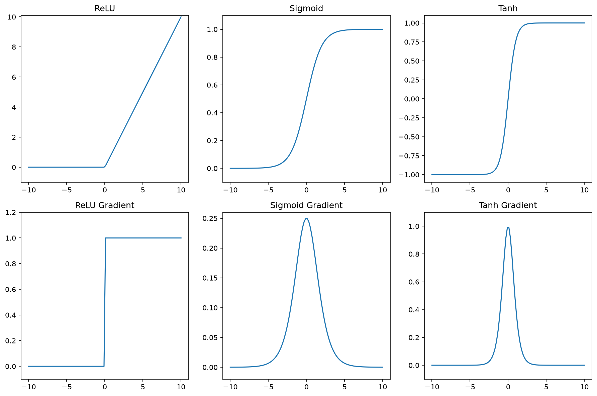
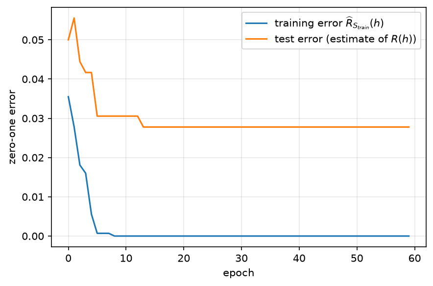
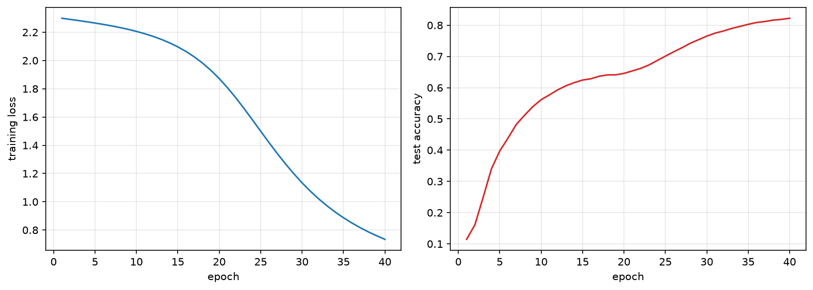

# Neuron (Perceptron)

A neuron, in the original form introduced as the **perceptron** [Rosenblatt (1958)](https://doi.org/10.1037/h0042519)<!-- cite: rosenblatt1958perceptron | article | author={Rosenblatt, Frank}; title={The Perceptron: A Probabilistic Model for Information Storage and Organization in the Brain}; journal={Psychological Review}; year={1958}; volume={65}; number={6}; pages={386--408} -->, is the basic unit of a neural network. A neuron identified by index $j$ has the following structure:
$$
\begin{aligned}
 z &= w_j^T x + b_j \\
 h &= g(z).
\end{aligned}
$$
Above,
  - $x$ is the input vector,
  - $w_j$ is the weight vector, which corresponds to the synapses of the neuron that admit input signals from the previous layer,
  - $g$ is the activation function that determines whether the neuron is activated or not,
  - $b_j$ is the bias, which is a constant,
  - $z$ is the linear activation of the neuron,
  - $h$ is the activation output of the neuron.

```{=latex}
\input{fig/perceptron.tex}
```

The first-generation activation function was the Heaviside step function:

$$g(z) = \begin{cases} 1 & \text{if } z \geq 0, \\ 0 & \text{otherwise.} \end{cases}$$

This construction, called a **perceptron**, is not popular nowadays since it is not differentiable. Modern neural networks use differentiable activation functions such as:

- Sigmoid function: $g(z) = \frac{1}{1+e^{-z}}$,
- Hyperbolic tangent function: $g(z) = \tanh(z)$,
- Rectified linear unit (ReLU): $g(z) = \max(0, z)$.

```python
import torch as th
import matplotlib.pyplot as plt

# The ReLU, Sigmoid, and Tanh activation functions can be plotted in
# different panels of a figure as below:

x = th.linspace(-10, 10, 100)
x.requires_grad = True  # Enable gradient tracking for x

# Create a figure with two rows and three columns of subplots
fig, axes = plt.subplots(2, 3, figsize=(12, 8))

# Plot the original functions in the top row
# ReLU
y_relu = th.relu(x)
axes[0, 0].plot(x.detach(), y_relu.detach())
axes[0, 0].set_title('ReLU')
axes[0, 0].set_ylim(-1, 10.1)

# Sigmoid
y_sigmoid = th.sigmoid(x)
axes[0, 1].plot(x.detach(), y_sigmoid.detach())
axes[0, 1].set_title('Sigmoid')
axes[0, 1].set_ylim(-0.1, 1.1)

# Tanh
y_tanh = th.tanh(x)
axes[0, 2].plot(x.detach(), y_tanh.detach())
axes[0, 2].set_title('Tanh')
axes[0, 2].set_ylim(-1.1, 1.1)

# Compute gradients
# Compute gradients using the automatic differentiation provided by PyTorch
grad_relu = th.autograd.grad(y_relu.sum(), x)[0].detach()
grad_sigmoid = th.autograd.grad(y_sigmoid.sum(), x)[0].detach()
grad_tanh = th.autograd.grad(y_tanh.sum(), x)[0].detach()

# Plot the gradients in the bottom row
axes[1, 0].plot(x.detach(), grad_relu)
axes[1, 0].set_title('ReLU Gradient')
axes[1, 0].set_ylim(-0.1, 1.2)

axes[1, 1].plot(x.detach(), grad_sigmoid)
axes[1, 1].set_title('Sigmoid Gradient')
axes[1, 1].set_ylim(-0.02, 0.26)  # Adjusted y-axis limits for sigmoid gradient

axes[1, 2].plot(x.detach(), grad_tanh)
axes[1, 2].set_title('Tanh Gradient')
axes[1, 2].set_ylim(-0.1, 1.1)

plt.tight_layout()

plt.show()

```



# Neural Network (Multilayer Perceptron)

A neural network is a collection of neurons. The neurons are organized in layers such that the activation output of the neurons in one layer become the synaptic inputs of the next layer.

```{=latex}
\input{fig/neural_network.tex}
```

The operation of $k$ neurons sharing the same layer $l$ on the $i$-th input can be given in the vector form below:

$$
\begin{aligned}
 z_n^l &= W_l^\top h_n^{l-1} + b^l, \\
 h_n^l &= g(z_n^l),
\end{aligned}
$$

where 

$$W_l= \begin{bmatrix} w_1^l & w_2^l & \cdots & w_k^l \end{bmatrix}$$

is the matrix of weight vectors and 

$$b^l=(b_1^l, \ldots, b_k^l)$$

is the vector of biases. The vector $h_n^l$ is called the **activation map** of layer $l$ for the $n$-th input. For $l=0$, the activation map is the input vector $x$, i.e. $h_n^0 := x_n$. The final pre-activation $z_n^H$ is the output $\widehat{y}_n$ of the neural network.

Assume we have a neural network with two layers. We can express its whole operation as:

$$\widehat{y}_n = W_2^\top g(W_1^\top x_n + b^1) + b^2.$$

Likewise, we can express the operation of a neural network with three layers as:

$$\widehat{y}_n = W_3^\top g(W_2^\top g(W_1^\top x_n + b^1) + b^2) + b^3.$$

# Training a Neural Network: Backpropagation

As with other machine learning models we covered thus far, neural networks are also trained to minimize a loss function. Denote the loss function by $\ell(y, \widehat{y})$ for a prediction $\widehat{y}$ and the true value $y$. Due to the cascaded application of the nonlinear activation functions, the loss function is not convex. Therefore, we cannot find the optimal solution analytically. Instead, we use gradient descent:

$$
\begin{aligned}
  w_{ij}^l := w_{ij}^l - \alpha \frac{\partial \ell}{\partial w_{ij}^l},
\end{aligned}
$$

for all synaptic connections $i \rightarrow j$ in all layers $l$. Given a neural network with $H$ layers, define $\widehat{y}_j = z_j^H$ as the output of the $j$ th neuron in the last layer. Also define

$$
\begin{aligned}
  \delta_j^l = \frac{\partial \ell}{\partial z_j^l}.
\end{aligned}
$$

This expression is called the **error** of the $j$ th neuron in the $l$ th layer. To see why, consider the case where $l=H$ and the loss function is the mean squared error: $\ell(y, \widehat{y}) = \frac{1}{2} \sum_{j} (y_j - \widehat{y}_j)^2$. Then we have

$$
\begin{aligned}
  \delta_j^H &= \frac{\partial \frac{1}{2} \sum_{j} (y_j - \widehat{y}_j)^2}{\partial z_j^H} \\
  &= \frac{\partial \frac{1}{2} (y_j - \widehat{y}_j)^2}{\partial \widehat{y}_j}\\
  &= \widehat{y}_j - y_j.
\end{aligned}
$$

This is the error of the prediction of the neural network on the $j$ output channel. The gradient of the loss with respect to an arbitrary weight is

$$
\begin{aligned}
  \frac{\partial \ell}{\partial w_{ij}^l} &= \frac{\partial \ell}{\partial z_j^l} \frac{\partial z_j^l}{\partial w_{ij}^l} \\
  &= \delta_j^l \frac{\partial z_j^l}{\partial w_{ij}^l}\\
  &= \delta_j^l h_i^{l-1}.
\end{aligned}
$$

Let us next calculate the error for an intermediate layer $l$. We have

$$
\begin{aligned}
  \delta_j^l &= \frac{\partial \ell}{\partial z_j^l} \\
  &= \sum_{k} \frac{\partial \ell}{\partial z_k^{l+1}} \frac{\partial z_k^{l+1}}{\partial z_j^l} \\
  &= \sum_{k} \delta_k^{l+1} \frac{\partial z_k^{l+1}}{\partial z_j^l}
\end{aligned}
$$

where $k$ ranges over the neurons in the next layer. Placing the definition of $z_k^{l+1}$ into the above equation, we have

$$
\begin{aligned}
 \frac{\partial z_k^{l+1}}{\partial z_j^l} &= \frac{\partial}{\partial z_j^l} \left( \sum_{j'} w_{j'k}^{l+1} g(z_{j'}^l) + b_{k}^{l+1} \right) \\
  &= w_{jk}^{l+1} \frac{\partial g(z_j^l)}{\partial z_j^l}.
\end{aligned}
$$

Placing this result into the above expression about the derivative of the error, we get

$$
\begin{aligned}
  \delta_j^l &=  \frac{\partial g(z_j^l)}{\partial z_j^l} \sum_{k} \delta_k^{l+1} w_{jk}^{l+1} 
\end{aligned}
$$

This way we obtain a recursive formula for the error of a neuron in an intermediate layer, where the recursion applies in the backward direction of the layers. There are remarkable facts regarding the computational efficiency of this formula that were first observed by Rumelhart et al. in 1986 and made the training of multilayer neural networks feasible:

 - It requires only $z_j^l$, which is already calculated during the forward pass.
 - Its computational cost is linear to the number of neurons in the network, i.e. $O(|W|)$ where $|W|$ is the number of weights in the network.

 The findings above can be put together into an algorithm and expressed as below.

1. Set $h^0 = x$ (the activation map of the input layer is the input itself).

2. **Forward Pass.** For $l=1 \rightarrow H$ do:
    - Compute and save $z_j^l = \sum_{i} w_{ij}^l h_i^{l-1} + b_j^l$ for every neuron $j$ in layer $l$.
    - If $l < H$, compute $h_j^l = g(z_j^l)$. If $l = H$, the network output is $\widehat{y}_j := z_j^H$.

3. **Backward Pass.** For $l=H \rightarrow 1$ do:
    - Compute $\delta_j^l = \frac{\partial g(z_j^l)}{\partial z_j^l} \sum_{k} \delta_k^{l+1} w_{jk}^{l+1}$ for every neuron $j$ in layer $l$ (for $l=H$, use $\delta_j^H = \widehat{y}_j - y_j$ directly, as derived above).
    - Compute $\frac{\partial \ell}{\partial w_{ij}^l} = \delta_j^l h_i^{l-1}$ for every synaptic connection $i \rightarrow j$.

This algorithm is called **backpropagation** [Rumelhart et al. (1986)](https://doi.org/10.1038/323533a0)<!-- cite: rumelhart1986learning | article | author={Rumelhart, David E. and Hinton, Geoffrey E. and Williams, Ronald J.}; title={Learning Representations by Back-Propagating Errors}; journal={Nature}; year={1986}; volume={323}; pages={533--536} -->. The name refers to the fact that the error term $\delta_j^l$ is propagated backward from the output layer to the input layer.

## Stochastic Gradient Descent

Above we explained the backpropagation algorithm for a single data point for simplicity. For a data set with $m$ samples, the gradient descent algorithm becomes:

$$
\begin{aligned}
 w_{ij}^l := w_{ij}^l - \alpha \frac{1}{m} \sum_{i=1}^m \frac{\partial \ell(y_i, \widehat{y}_i)}{\partial w_{ij}^l},
\end{aligned}
$$

This means we need to do a forward pass and a backward pass for all weights and all data points. This is computationally expensive for large data sets. Instead, we can use a technique called **stochastic gradient descent**. In this technique, we use a subset of the data set, called a **mini-batch**, to calculate the gradient. The size of the mini-batch is denoted by $b$. The stochastic gradient descent algorithm can be expressed as:

$$
\begin{aligned}
   B &\subseteq S, \quad |B| = b, \quad B \text{ drawn uniformly at random} \\
  w_{ij}^l &:= w_{ij}^l - \alpha \frac{1}{b} \sum_{i=1}^b \frac{\partial \ell(y_i, \widehat{y}_i)}{\partial w_{ij}^l},
\end{aligned}
$$

where the first step draws a mini-batch $B$ uniformly at random from the **training set** $S$ — not from the data distribution $\mathcal{D}$, which we cannot sample from — and the second step performs a gradient descent update using the backpropagation algorithm. The random selection makes the gradient signal a random variable. This is why the algorithm is called stochastic gradient descent. Because $B$ is drawn uniformly from $S$, this random variable is an unbiased estimate of the full-batch gradient over $S$, i.e. of the gradient of the empirical risk $\widehat{R}_S$. Hence, under mild conditions (a suitably decaying learning rate $\alpha$, among others) clarified by [Robbins and Monro (1951)](https://doi.org/10.1214/aoms/1177729586)<!-- cite: robbins1951stochastic | article | author={Robbins, Herbert and Monro, Sutton}; title={A Stochastic Approximation Method}; journal={The Annals of Mathematical Statistics}; year={1951}; volume={22}; number={3}; pages={400--407} -->, the algorithm is guaranteed to converge to a stationary point of the loss, just as deterministic gradient descent is. Since the neural network loss is generally non-convex, owing to the cascaded, nonlinear composition of layers described above, neither algorithm is guaranteed to reach the *same* stationary point, or the global optimum; in practice the noise injected by the mini-batch sampling is even considered beneficial, as it helps the current parameter estimate (the *iterate*) escape poor local stationary points that plain gradient descent could get stuck in.

## Backpropagation in Matrix Form

The scalar recursion above is what one implements on paper; what one implements on a computer is its **batched matrix** form, which processes all $b$ examples of a mini-batch $B$ in one pass and maps one-to-one onto the code of the next section. Stack the activation maps of the mini-batch as rows,

$$\begin{gathered}
\mathbf{H}^{l} := \begin{bmatrix} (h_1^{l})^\top \\ \vdots \\ (h_b^{l})^\top \end{bmatrix} \in \mathbb{R}^{b \times k_l}, \\
\mathbf{H}^0 := \mathbf{X} \in \mathbb{R}^{b\times d},
\end{gathered}$$

and collect the layer errors in the same layout, $\mathbf{\Delta}^l := \partial \widehat{R}_B / \partial \mathbf{Z}^l \in \mathbb{R}^{b \times k_l}$, whose $(n,j)$-th entry is the error $\delta_j^l$ of neuron $j$ on example $n$. Then the entire algorithm is six matrix identities:

$$
\begin{aligned}
\textbf{(F1)}\quad \mathbf{Z}^l &= \mathbf{H}^{l-1} W_l + \mathbf{1}_b (b^l)^\top, & W_l &\in \mathbb{R}^{k_{l-1}\times k_l}, \\
\textbf{(F2)}\quad \mathbf{H}^l &= g(\mathbf{Z}^l) & &\text{(elementwise)}, \\
\textbf{(B1)}\quad \mathbf{\Delta}^H &= \tfrac{1}{b}\big(\widehat{\mathbf{Y}} - \mathbf{Y}\big), & &\text{(output layer)}\\
\textbf{(B2)}\quad \mathbf{\Delta}^{l-1} &= \big(\mathbf{\Delta}^{l} W_l^\top\big) \odot g'(\mathbf{Z}^{l-1}), & &\text{(recursion)}\\
\textbf{(B3)}\quad \partial \widehat{R}_B / \partial W_l &= (\mathbf{H}^{l-1})^\top \mathbf{\Delta}^l, & &\\
\textbf{(B4)}\quad \partial \widehat{R}_B / \partial b^l &= (\mathbf{\Delta}^l)^\top \mathbf{1}_b, & &
\end{aligned}
$$

where $\odot$ is the elementwise (Hadamard) product and $\mathbf{1}_b \in \mathbb{R}^b$ is the all-ones vector. (F1)-(F2) are the forward pass; (B1)-(B4) are the backward pass. Two observations:

* **(B3) is the scalar rule $\partial \ell/\partial w_{ij}^l = \delta_j^l h_i^{l-1}$, summed over the mini-batch** — the matrix product $(\mathbf{H}^{l-1})^\top\mathbf{\Delta}^l$ performs exactly that sum, which is why one gradient step costs one matrix multiplication per layer rather than $|W|$ scalar operations. (The averaging factor $1/b$ that turns the sum into the mini-batch mean has already been folded into $\mathbf{\Delta}^H$ by (B1), so it needs no separate mention here.)
* **(B2) is the scalar recursion $\delta_j^l = g'(z_j^l)\sum_k \delta_k^{l+1} w_{jk}^{l+1}$** — the sum over the next layer's neurons $k$ is the product with $W_l^\top$, and multiplying by $g'$ is the Hadamard product. Every layer therefore needs exactly two things from its forward pass: its input $\mathbf{H}^{l-1}$ (for B3) and its pre-activation $\mathbf{Z}^{l}$ (for $g'$ in B2). This is the entire content of the "cache the forward pass" instruction in the algorithm above.

**(B1) for the softmax cross-entropy loss.** We derived $\delta_j^H = \widehat{y}_j - y_j$ for the squared loss. For $C$-class classification the output layer is instead passed through a **softmax**,

$$\begin{gathered}
\widehat{y}_j := \frac{\exp(z_j^H)}{\sum_{c=1}^C \exp(z_c^H)}, \\
\ell(y,\widehat{y}) := -\sum_{c=1}^C y_c \log \widehat{y}_c \quad (y \text{ one-hot, i.e. } y_c = \mathds{1}(c = \text{true class})),
\end{gathered}$$

and a short calculation gives the *same* form. Writing $\widehat y_j = \exp(z_j)/Z$ with $Z := \sum_c \exp(z_c)$,

$$\begin{gathered}
\frac{\partial \widehat{y}_c}{\partial z_j^H} = \widehat{y}_c\big(\mathds{1}(c{=}j) - \widehat{y}_j\big) \\
\Longrightarrow\quad \frac{\partial \ell}{\partial z_j^H} = -\sum_{c} \frac{y_c}{\widehat y_c}\,\widehat{y}_c\big(\mathds{1}(c{=}j)-\widehat y_j\big) = -y_j + \widehat y_j \sum_c y_c = \widehat{y}_j - y_j,
\end{gathered}$$

using $\sum_c y_c = 1$. So $\delta_j^H = \widehat y_j - y_j$ holds for the squared loss with a linear output *and* for the cross-entropy loss with a softmax output: in both cases the error that starts the backward recursion is simply **prediction minus target**. This is not a coincidence. It holds for every matched pair of a probability-model output layer (softmax here — one from the standard catalogue of distributions, the *exponential family*, that statistics uses for this purpose) and the loss equal to the negative logarithm of the probability that model assigns to the observed label (called its *negative log-likelihood*). We will meet this pairing again from the modeling side in Chapter 6.

# Implementation: A Multilayer Perceptron From Scratch

We now implement (F1)-(F2) and (B1)-(B4) literally, with no automatic differentiation anywhere: each layer is an object exposing a `forward` map and the corresponding explicitly coded `backward` map, and the optimizer is the four-line stochastic gradient step of the previous section. Two things are worth watching for in the code below.

* **Every `backward` is one of the identities above**, in the same order: `Affine.backward` implements (B3), (B4) and the factor $\mathbf{\Delta}^l W_l^\top$ of (B2); `ReLU.backward` supplies the remaining $\odot\, g'(\mathbf{Z})$ factor; `SoftmaxCrossEntropy.backward` is (B1).
* **The gradients are verified against finite differences.** Since we claim to have differentiated the network by hand, we check that claim numerically: for a random weight $w$, the central difference $\big(\widehat{R}(w{+}\epsilon)-\widehat{R}(w{-}\epsilon)\big)/(2\epsilon)$ must agree with the analytic gradient to within the $O(\epsilon^2)$ truncation error. This **gradient check** is the standard way to debug a hand-written backward pass, and is worth internalizing as a technique in its own right.

The data set is `digits`: $1797$ real handwritten digits scanned as $8\times8$ grayscale images ($d=64$ features, $C=10$ classes) — the same task as the MNIST example below, at a scale that trains from scratch in seconds.

```python
# A multilayer perceptron implemented from scratch: every forward map, every
# backward map, and every gradient step is written out explicitly as a tensor
# operation. No automatic differentiation is used anywhere in this block --
# not a single tensor below carries requires_grad.

import torch as th
import matplotlib.pyplot as plt
from sklearn.datasets import load_digits

th.manual_seed(0)

# Every tensor below is float64: the finite-difference gradient check needs
# more precision than the float32 that the libraries use by default.

# --- Affine layer: (F1) Z = H W + 1 b^T -------------------------------------

class Affine:
    def __init__(self, k_in, k_out):
        # He initialisation: Var[w] = 2/k_in keeps Var[z^l] ~ Var[z^{l-1}]
        self.W = th.randn(k_in, k_out, dtype=th.float64) * (2.0 / k_in) ** 0.5
        self.b = th.zeros(k_out, dtype=th.float64)

    def forward(self, H):
        self.H = H                       # cached: needed by (B3)
        return H @ self.W + self.b       # (b,k_in)(k_in,k_out) -> (b,k_out)

    def backward(self, Delta):
        # Delta = dR/dZ^l, shape (b,k_out). One line per identity:
        self.dW = self.H.T @ Delta       # (B3)  dR/dW_l = (H^{l-1})^T Delta^l
        self.db = Delta.sum(dim=0)       # (B4)  dR/db^l = (Delta^l)^T 1
        return Delta @ self.W.T          # (B2)  first factor: Delta^l W_l^T

    def step(self, alpha):
        self.W -= alpha * self.dW        # gradient step on the weights
        self.b -= alpha * self.db        # gradient step on the biases

# --- Activation layer: (F2) H = g(Z), with g the ReLU -----------------------

class ReLU:
    def forward(self, Z):
        self.mask = (Z > 0.0).to(Z.dtype)  # cached: this IS g'(Z)
        return Z * self.mask               # g(z) = max(0,z)

    def backward(self, dH):
        return dH * self.mask            # (B2) second factor: o g'(Z^{l-1})

    def step(self, alpha):
        pass                             # no parameters to update

# --- Loss layer: softmax + cross entropy, differentiated jointly ------------

class SoftmaxCrossEntropy:
    def forward(self, Z, Y):
        Z = Z - Z.max(dim=1, keepdim=True).values     # shift: exp cannot overflow
        E = Z.exp()
        self.Yhat = E / E.sum(dim=1, keepdim=True)    # softmax probabilities
        self.Y = Y                                    # one-hot targets (see above)
        return -(Y * (self.Yhat + 1e-12).log()).sum() / Z.shape[0]

    def backward(self):
        return (self.Yhat - self.Y) / self.Y.shape[0] # (B1) delta^H = yhat - y

# --- The network: a list of layers, traversed forwards, then backwards ------

class MLP:
    def __init__(self, sizes):
        self.layers = []
        for l in range(len(sizes) - 1):
            self.layers.append(Affine(sizes[l], sizes[l + 1]))
            if l < len(sizes) - 2:                    # no activation on output
                self.layers.append(ReLU())
        self.loss = SoftmaxCrossEntropy()

    def forward(self, X, Y):
        H = X                                         # H^0 := X
        for layer in self.layers:                     # l = 1 -> H
            H = layer.forward(H)
        return self.loss.forward(H, Y)

    def backward(self):
        Delta = self.loss.backward()                  # delta^H
        for layer in reversed(self.layers):           # l = H -> 1
            Delta = layer.backward(Delta)

    def step(self, alpha):
        for layer in self.layers:
            layer.step(alpha)

    def predict(self, X):
        H = X
        for layer in self.layers:
            H = layer.forward(H)
        return H.argmax(dim=1)

# --- Gradient check: analytic backward pass vs. central finite differences --

net = MLP([5, 4, 3])
Xc = th.randn(6, 5, dtype=th.float64)
Yc = th.eye(3, dtype=th.float64)[th.randint(0, 3, (6,))]
net.forward(Xc, Yc)
net.backward()
W = net.layers[0].W                                   # differentiate w.r.t. W_1
dW_analytic = net.layers[0].dW.clone()
eps, dW_numeric = 1e-6, th.zeros_like(W)
for i in range(W.shape[0]):
    for j in range(W.shape[1]):
        W[i, j] += eps;     Rp = net.forward(Xc, Yc)
        W[i, j] -= 2 * eps; Rm = net.forward(Xc, Yc)
        W[i, j] += eps
        dW_numeric[i, j] = (Rp - Rm) / (2 * eps)
print("max |analytic - numeric| gradient error:",
      f"{(dW_analytic - dW_numeric).abs().max():.2e}")

# --- The pipeline: 8x8 handwritten digits, 1797 samples, 10 classes ---------

digits = load_digits()
X_all = th.tensor(digits.data, dtype=th.float64) / 16.0  # pixel range [0,1]
y_all = th.tensor(digits.target, dtype=th.long)

idx = th.randperm(y_all.numel())
n_tr = int(0.8 * y_all.numel())
tr, te = idx[:n_tr], idx[n_tr:]
mu, sd = X_all[tr].mean(dim=0), X_all[tr].std(dim=0) + 1e-8
X_tr, X_te = (X_all[tr] - mu) / sd, (X_all[te] - mu) / sd
y_tr, y_te = y_all[tr], y_all[te]
Y_tr = th.eye(10, dtype=th.float64)[y_tr]  # one-hot targets: row i of the identity matrix, a 1 in the true class's slot and 0 elsewhere

net = MLP([64, 64, 32, 10])                           # d=64 -> 64 -> 32 -> C=10
alpha, batch_size, epochs = 0.5, 32, 60
curve_tr, curve_te = [], []

for epoch in range(epochs):
    order = th.randperm(n_tr)                         # B ~ Uniform(S), |B| = b
    for start in range(0, n_tr, batch_size):
        B = order[start:start + batch_size]
        net.forward(X_tr[B], Y_tr[B])                 # forward pass  (F1),(F2)
        net.backward()                                # backward pass (B1)-(B4)
        net.step(alpha)                               # stochastic gradient step
    curve_tr.append((net.predict(X_tr) != y_tr).double().mean())
    curve_te.append((net.predict(X_te) != y_te).double().mean())

print(f"train error: {curve_tr[-1]:.4f}   test error: {curve_te[-1]:.4f}")

plt.figure(figsize=(6, 4))
plt.plot(curve_tr, label="training error $\\widehat{R}_{S_{train}}(h)$")
plt.plot(curve_te, label="test error (estimate of $R(h)$)")
plt.xlabel("epoch"); plt.ylabel("zero-one error"); plt.legend(); plt.grid(alpha=.3)
plt.tight_layout()
plt.show()
```

    max |analytic - numeric| gradient error: 9.15e-11
    train error: 0.0000   test error: 0.0278



The analytic and numerical gradients agree to within $10^{-10}$, confirming that the four backward identities are implemented correctly. The learning curve shows the training error driven to exactly $0$ — the network has $64\cdot64 + 64\cdot32 + 32\cdot10 = 6{,}464$ weights against $m=1437$ training examples, so it can interpolate the training set outright — while the test error settles near $3\%$. This is the empirical form of the puzzle the next section addresses: a hypothesis class whose VC dimension far exceeds $m$, achieving $\widehat{R}_{S_{train}}(h)=0$ on its training set, and generalizing anyway.

# PAC Analysis of Neural Networks

A two-layer network with $k$ hidden units and unconstrained real-valued weights has $O(k \cdot (d+1) + k)$ trainable parameters, and its VC dimension grows accordingly — for the sign-thresholded output of a network with piecewise-linear activations (e.g. ReLU), $d_{VC}$ scales at least linearly, and can scale super-linearly, in the number of weights. For any network wide enough to be useful in practice, this VC dimension vastly exceeds the number of training examples $m$, so the VC-dimension bound of Theorem 5.4 is **vacuous**: it promises nothing, since its right-hand side exceeds $1$. Yet, deep networks with far more parameters than training examples routinely generalize well. Resolving this puzzle needs a complexity measure that does not grow with the number of parameters — exactly the motivation behind Rademacher complexity (Chapter 5a). We now derive such a bound for a simplified network, using only the tools already built in Chapter 5a.

**Simplified setup.** Consider a network with a single hidden layer of $k$ units and a scalar output,

$$\begin{gathered}
h_{W,w}(x) = w^\top g(Wx), \\
W \in \mathbb{R}^{k \times d},\ w \in \mathbb{R}^k,
\end{gathered}$$

where $g$ is applied elementwise. We assume:

* $g$ is $1$-Lipschitz with $g(0)=0$ — true for ReLU (and for $\tanh$, but *not* for the sigmoid, whose offset $g(0)=\tfrac12$ would need to be carried through the argument separately);
* every row $w_j^{(1)}$ of $W$ (the incoming weight vector of hidden unit $j$) satisfies $\|w_j^{(1)}\|_2 \leq B_1$;
* the output weights satisfy $\|w\|_2 \leq B_2$;
* $\|x\|_2 \leq R$ almost surely under $\mathcal{D}$.

Write $\mathcal{H}_{k,B_1,B_2}$ for the resulting hypothesis class. Note that $k$, $B_1$, $B_2$ are hyperparameters we are free to fix in advance — capping them plays exactly the role that capping the leaf budget $L$ played for decision trees in Chapter 7's own PAC analysis.

**Theorem 8.1 (Rademacher complexity of a two-layer network).**

$$\widehat{\mathfrak{R}}_S(\mathcal{H}_{k,B_1,B_2}) \leq \frac{2\sqrt{k}\,B_1 B_2 R}{\sqrt{m}}.$$

**Proof.** Fix the sample $S = \{x_1,\ldots,x_m\}$. Since $h_{W,w}(x) = \sum_{j=1}^k w_j\, g(w_j^{(1)\top}x)$ is linear in $w$, the supremum over $\|w\|_2 \leq B_2$ of a linear functional is attained by Cauchy-Schwarz, for every fixed realization of the Rademacher signs $\sigma_1,\ldots,\sigma_m$:

$$
\begin{aligned}
\widehat{\mathfrak{R}}_S(\mathcal{H}_{k,B_1,B_2}) &= \mathbb{E}_\sigma\Big[\sup_{W,w} \frac{1}{m}\sum_{i=1}^m \sigma_i\, w^\top g(Wx_i)\Big] = \frac{B_2}{m}\, \mathbb{E}_\sigma\Big[\sup_{W} \Big\| \sum_{i=1}^m \sigma_i\, g(Wx_i) \Big\|_2\Big].
\end{aligned}
$$

Write $v_j(W) := \sum_i \sigma_i\, g(w_j^{(1)\top}x_i)$ for the $j$-th coordinate of the inner vector, where $w_j^{(1)}$ is the $j$-th row of $W$. Bounding the Euclidean norm by $\sqrt{k}$ times the sup-norm, and using that the $k$ rows range independently over identical $B_1$-balls (so the outer supremum and the coordinate-wise maximum commute),

$$
\begin{aligned}
\sup_{W} \big\| v(W) \big\|_2 &\leq \sqrt{k}\, \sup_{W} \max_{j} |v_j(W)| = \sqrt{k}\, \max_j \sup_{\|w_j^{(1)}\|_2 \leq B_1} |v_j(W)| \\
&= \sqrt{k}\, \sup_{\|u\|_2 \leq B_1} \Big|\sum_i \sigma_i\, g(u^\top x_i)\Big|,
\end{aligned}
$$

where the last equality holds because every one of the $k$ terms being maximized over is, by construction, the *same* scalar quantity — the row index $j$ only labels which weight vector we call $u$, the constraint set $\{\|u\|_2\le B_1\}$ and the data $x_1,\ldots,x_m$ being identical for every hidden unit. This collapses a $k$-fold maximum into a single scalar supremum, over a class with a single $B_1$-norm-bounded weight vector. The supremum is of an absolute value, so the contraction lemma enters in its signed form (5a.1) of Chapter 5a, which applies because the set $\{(u^\top x_1,\ldots,u^\top x_m) : \|u\|_2 \leq B_1\}$ contains $0$ and $g(0) = 0$; it costs a factor $2$:

$$\mathbb{E}_\sigma\Big[\sup_{\|u\|_2 \leq B_1} \Big|\sum_i \sigma_i\, g(u^\top x_i)\Big|\Big] \leq 2\,\mathbb{E}_\sigma\Big[\sup_{\|u\|_2 \leq B_1} \sum_i \sigma_i\, u^\top x_i\Big] = 2B_1\, \mathbb{E}_\sigma\Big[\Big\|\sum_i \sigma_i x_i\Big\|_2\Big],$$

the last equality by Cauchy-Schwarz. Finally, by Jensen's inequality and $\mathbb{E}[\sigma_i\sigma_{i'}]=0$ for $i\neq i'$,

$$\mathbb{E}_\sigma\Big[\Big\|\sum_i \sigma_i x_i\Big\|_2\Big] \leq \sqrt{\mathbb{E}_\sigma\Big[\Big\|\sum_i \sigma_i x_i\Big\|_2^2\Big]} = \sqrt{\sum_i \|x_i\|_2^2} \leq R\sqrt{m}.$$

Assembling the pieces, $\widehat{\mathfrak{R}}_S(\mathcal{H}_{k,B_1,B_2}) \leq \frac{B_2}{m}\cdot \sqrt{k}\cdot 2B_1 \cdot R\sqrt{m} = \frac{2\sqrt{k}\,B_1B_2 R}{\sqrt{m}}$. $\square$

**Consequences.** Plugging Theorem 8.1 into Theorem 5a.2 (after one more application of the contraction lemma to pass from $\mathcal{H}_{k,B_1,B_2}$ to a Lipschitz loss composed with it) gives, with probability at least $1-\delta$, simultaneously for every $h \in \mathcal{H}_{k,B_1,B_2}$,

$$R(h) \leq \widehat{R}_S(h) + O\Big(\frac{\sqrt{k}\, B_1 B_2 R}{\sqrt{m}}\Big) + O\Big(\sqrt{\frac{\log(1/\delta)}{m}}\Big).$$

Three things are worth noting about this bound:

* It **does not depend on the input dimension $d$** — only on the per-neuron weight-norm bound $B_1$, the output-norm bound $B_2$, the data-norm bound $R$, and the width $k$. This is precisely the phenomenon flagged in Theorem 5a.4: capacity control by norm, rather than by counting parameters, is what makes the bound meaningful for models with far more parameters than $VC$-dimension arguments could ever tolerate.
* It scales with $\sqrt{k}$, not with the number of parameters $k(d+1)$. Width still costs something — but far less than a naive parameter-counting argument (à la Theorem 5.4) would suggest. This residual $\sqrt k$ is an *artifact of the $L_2$ constraint* on the output weights: Theorem 8.2 below shows that it disappears once the output weights are constrained in the $L_1$ norm instead.

* The bound gives no credit to gradient descent for finding a good hypothesis — it only certifies that *if* training happens to land on a hypothesis with small weight norms, that hypothesis generalizes well. This matches an empirical regularity of trained networks: gradient descent on over-parameterized networks tends to find solutions with small weight norms even without explicit regularization, an implicit-bias phenomenon that is an active research topic — and it is exactly why this norm-based, width-independent view of capacity, rather than the VC-dimension view, is the one that matches practice. We revisit this network in a further-simplified, exactly solvable form — where only the output layer is trained and the hidden layer is fixed — in the Neural Tangent Kernel discussion of Chapter 9.

**Theorem 8.2 (Width-independent bound for an $L_1$-constrained output layer).** In the same setup as Theorem 8.1 — $g$ $1$-Lipschitz with $g(0)=0$, $\|w_j^{(1)}\|_2 \leq B_1$ per hidden unit, $\|x\|_2 \leq R$ — replace the output constraint $\|w\|_2 \leq B_2$ by
$$\|w\|_1 := \sum_{j=1}^k |w_j| \;\leq\; B_2,$$
and write $\mathcal{H}^{(1)}_{k,B_1,B_2}$ for the resulting class. Then for every sample $S$,
$$\widehat{\mathfrak{R}}_S\big(\mathcal{H}^{(1)}_{k,B_1,B_2}\big) \;\leq\; \frac{2B_1 B_2 R}{\sqrt{m}},$$
with **no dependence on the width $k$** on the right-hand side.

**Proof.** Fix the signs $\sigma$ and abbreviate $c(u) := \frac1m\sum_{i=1}^m \sigma_i\, g(u^\top x_i)$ for the correlation of a single hidden unit $u$. A hypothesis restricted to $S$ is the vector $\big(\sum_j w_j g(w_j^{(1)\top}x_i)\big)_{i=1}^m$, so
$$\sup_{W,w} \frac1m \sum_{i=1}^m \sigma_i h_{W,w}(x_i) \;=\; \sup_{W,w} \sum_{j=1}^k w_j\, c\big(w_j^{(1)}\big) \;\leq\; \sup_{W,w} \sum_{j=1}^k |w_j|\, \big|c\big(w_j^{(1)}\big)\big| \;\leq\; \Big(\sum_{j=1}^k |w_j|\Big)\, \sup_{\|u\|_2 \leq B_1} |c(u)| \;\leq\; B_2 \sup_{\|u\|_2 \leq B_1} |c(u)|,$$
where the second inequality pulls the total $L_1$ mass out of the sum, and the third applies the constraint. The point is that the sup over $W$ of the individual correlations $\lvert c(w_j^{(1)})\rvert$ collapses to a single scalar supremum, exactly as in Theorem 8.1's proof — the row index $j$ labels identical constraint sets, so maximizing the weighted sum with an $L_1$ budget puts all mass on the single best hidden unit (a vertex of the $L_1$ ball). Taking $\mathbb{E}_\sigma$ and applying the same chain as in Theorem 8.1's proof (signed contraction (5a.1) for the $1$-Lipschitz $g$ with $g(0)=0$, Cauchy-Schwarz, Jensen) gives
$$\widehat{\mathfrak{R}}_S\big(\mathcal{H}^{(1)}_{k,B_1,B_2}\big) \;\leq\; B_2\, \mathbb{E}_\sigma\Big[\sup_{\|u\|_2 \leq B_1} \big|c(u)\big|\Big] \;\leq\; B_2\cdot\frac{2B_1 R\sqrt{m}}{m} \;=\; \frac{2B_1 B_2 R}{\sqrt{m}}. \qquad\square$$

Bounds of this type, in which the size of the weights rather than the size of the network controls capacity, go back to [Bartlett (1998)](https://doi.org/10.1109/18.661502)<!-- cite: bartlett1998sample | article | author={Bartlett, Peter L.}; title={The Sample Complexity of Pattern Classification with Neural Networks: The Size of the Weights Is More Important than the Size of the Network}; journal={IEEE Transactions on Information Theory}; year={1998}; volume={44}; number={2}; pages={525--536} -->. The comparison between Theorems 8.1 and 8.2 is the cleanest illustration of **Theorem 5a.9's moral in action**. The $\sqrt k$ in Theorem 8.1 is precisely the cost of the $L_2$ constraint, measured in $L_1$ terms: by norm equivalence $\|w\|_1 \leq \sqrt{k}\,\|w\|_2$, an $L_2$-constrained network has total output weight at most $\sqrt k\,B_2$, and Theorem 8.2 charges exactly that total — so Theorem 8.1 is recovered by norm conversion. Conversely, the $L_1$ form shows that the width is a *bookkeeping device*: the class of $L_1$-constrained combinations is no richer, in Rademacher terms, than the class of its single hidden units (scaled by the budget $B_2$), no matter how large $k$ is. The same accounting by total weight underlies the gradient-boosting guarantee of Chapter 10: the price of an ensemble is its total weight, not its member count. Both theorems still constrain each hidden unit separately; the refinement of Golowich, Rakhlin & Shamir (2018) extends the accounting to norms of the hidden weight matrices, and to deeper networks.

**Why does SGD generalize?** The bounds of this section are *capacity-based*: they certify any low-norm hypothesis the training run happens to land on, and give the training algorithm no credit. A complementary analysis prices the algorithm itself, through **uniform stability** (Definition 5a.3 and Theorem 5a.10 of Chapter 5a). We carry it out for SGD with single-example updates on a loss $\phi(w,z)$ that is convex in the parameters $w \in \mathbb{R}^p$ — for instance logistic regression (Chapter 3), or a network whose hidden layer is frozen and only the output layer is trained. Two properties of smooth functions are needed. A differentiable $f:\mathbb{R}^p\to\mathbb{R}$ is **$\beta$-smooth** if its gradient is $\beta$-Lipschitz, $\|\nabla f(u) - \nabla f(v)\|_2 \leq \beta\|u-v\|_2$.

**Lemma 8.1 (Smooth convex functions).** Let $f$ be $\beta$-smooth. Then for all $u,v$:

*(i)* $f(v) \leq f(u) + \nabla f(u)^\top(v-u) + \frac\beta2\|v-u\|_2^2$;

*(ii)* if $f$ is also convex, $\big(\nabla f(u) - \nabla f(v)\big)^\top(u-v) \geq \frac1\beta\|\nabla f(u) - \nabla f(v)\|_2^2$;

*(iii)* if $f$ is also convex and $0 < \alpha \leq 2/\beta$, the gradient step $G(u) := u - \alpha\nabla f(u)$ satisfies $\|G(u) - G(v)\|_2 \leq \|u - v\|_2$.

**Proof.** *(i)* By the fundamental theorem of calculus along the segment from $u$ to $v$, Cauchy-Schwarz and smoothness,
$$f(v) - f(u) - \nabla f(u)^\top(v-u) = \int_0^1\big(\nabla f(u + t(v-u)) - \nabla f(u)\big)^\top(v-u)\,dt \;\leq\; \int_0^1 \beta t\,\|v-u\|_2^2\,dt = \frac\beta2\|v-u\|_2^2.$$
*(ii)* Fix $u$ and let $\psi(y) := f(y) - \nabla f(u)^\top y$. It is convex and $\beta$-smooth with $\nabla\psi(u) = 0$, so $u$ minimizes $\psi$. Applying (i) to $\psi$ at the point $y - \frac1\beta\nabla\psi(y)$,
$$\psi(u) \;\leq\; \psi\big(y - \tfrac1\beta\nabla\psi(y)\big) \;\leq\; \psi(y) - \tfrac1\beta\|\nabla\psi(y)\|_2^2 + \tfrac{1}{2\beta}\|\nabla\psi(y)\|_2^2 = \psi(y) - \tfrac{1}{2\beta}\|\nabla f(y) - \nabla f(u)\|_2^2.$$
Written out, $f(u) \leq f(y) + \nabla f(u)^\top(u - y) - \frac1{2\beta}\|\nabla f(y) - \nabla f(u)\|_2^2$. Adding this inequality to the same one with $u$ and $y$ exchanged, and setting $y = v$, gives (ii).

*(iii)* Expanding the square and using (ii),
$$\|G(u)-G(v)\|_2^2 = \|u-v\|_2^2 - 2\alpha\big(\nabla f(u)-\nabla f(v)\big)^\top(u-v) + \alpha^2\|\nabla f(u)-\nabla f(v)\|_2^2 \;\leq\; \|u-v\|_2^2 - \alpha\Big(\frac2\beta - \alpha\Big)\|\nabla f(u)-\nabla f(v)\|_2^2,$$
and the last term is non-positive for $\alpha \leq 2/\beta$ $\square$

All three facts are standard in convex optimization; see Chapter 2 of [Nesterov (2004)](https://doi.org/10.1007/978-1-4419-8853-9)<!-- cite: nesterov2004introductory | book | author={Nesterov, Yurii}; title={Introductory Lectures on Convex Optimization: A Basic Course}; publisher={Springer}; year={2004} -->.

**Theorem 8.3 (SGD is uniformly stable).** Let $\phi(w,z)$ be convex and $\beta$-smooth in $w$, with $\|\nabla_w\phi(w,z)\|_2 \leq G$ for all $w,z$. Given $S = (z_1,\ldots,z_m)$, let SGD start from a fixed $w_0$, draw $i_t$ uniformly from $[m]$ independently at each step, and update
$$w_{t+1} := w_t - \alpha_t\nabla_w\phi(w_t,z_{i_t}), \qquad 0 < \alpha_t \leq 2/\beta, \qquad t = 0,\ldots,T-1.$$
The algorithm that returns $w_T$ is $\epsilon$-uniformly stable with
$$\epsilon \;=\; \frac{2G^2}{m}\sum_{t=0}^{T-1}\alpha_t.$$

**Proof.** Let $S'$ differ from $S$ in position $i$ only, and run SGD on both with the **same** index sequence $i_0,i_1,\ldots$; this coupling does not change the law of either run. Let $w_t, w_t'$ be the two iterates and $\delta_t := \|w_t - w_t'\|_2$, so $\delta_0 = 0$. If $i_t \neq i$, both runs apply the gradient step of the *same* function $\phi(\cdot,z_{i_t})$, and Lemma 8.1(iii) gives $\delta_{t+1} \leq \delta_t$. If $i_t = i$, the triangle inequality and the gradient bound give $\delta_{t+1} \leq \delta_t + \alpha_t\|\nabla_w\phi(w_t,z_i)\|_2 + \alpha_t\|\nabla_w\phi(w_t',z_i')\|_2 \leq \delta_t + 2\alpha_t G$. The second case occurs with probability $\tfrac1m$, independently of $\delta_t$, so
$$\mathbb{E}[\delta_{t+1}] \;\leq\; \mathbb{E}[\delta_t] + \frac{2\alpha_t G}{m}, \qquad\text{hence}\qquad \mathbb{E}[\delta_T] \leq \frac{2G}{m}\sum_{t<T}\alpha_t.$$
The gradient bound makes $\phi(\cdot,z)$ $G$-Lipschitz, so for every $z$, $\big|\mathbb{E}\,\phi(w_T,z) - \mathbb{E}\,\phi(w_T',z)\big| \leq G\,\mathbb{E}[\delta_T]$ $\square$

Plugging Theorem 8.3 into Theorem 5a.10 bounds the generalization gap of the *iterate SGD actually returns*, with no complexity term:
$$\mathbb{E}_S\mathbb{E}_{\text{SGD}}\big[R(w_T) - \widehat{R}_S(w_T)\big] \;\leq\; \frac{2G^2}{m}\sum_{t<T}\alpha_t.$$
The bound grows with the number of steps: running longer lowers the training loss but raises the stability parameter, an optimization–generalization trade-off expressed entirely through the step sizes. One pass over the data ($T = m$) with constant step $\alpha = c/\sqrt m$ gives a gap of at most $2cG^2/\sqrt m$. The result is due to [Hardt, Recht & Singer (2016)](https://proceedings.mlr.press/v48/hardt16.html)<!-- cite: hardt2016train | inproceedings | author={Hardt, Moritz and Recht, Benjamin and Singer, Yoram}; title={Train Faster, Generalize Better: Stability of Stochastic Gradient Descent}; booktitle={Proceedings of the 33rd International Conference on Machine Learning}; series={PMLR}; volume={48}; year={2016}; pages={1225--1234} -->, who also treat strongly convex losses, where the gap is $O(1/m)$ uniformly in $T$, and non-convex smooth losses, where it grows polynomially in $T$. Convexity enters the proof only through Lemma 8.1(iii); for a full network trained end to end it fails, and neither the capacity nor the stability analysis is sharp — the two are complementary partial explanations of why over-parameterized networks generalize.

Nearly every neural network used nowadays is trained by minimizing a loss function using stochastic gradient descent with backpropagation. The common practice is to use an automatic differentiation library such as TensorFlow or PyTorch that automates the process of calculating the gradients. These libraries also provide a variety of neural network architectures and optimization algorithms. Below, we give an example implementation of a neural network using PyTorch on a handwritten digit classification problem. The data set used is among the most famous data sets in machine learning, called MNIST. It contains 70,000 images of handwritten digits. Each image is a 28x28 grayscale image. The goal is to classify the images into 10 classes, one for each digit.

```python
# MNIST digits classification with a simple deep neural network,
# this time written the way it is written in practice: with the library's
# own layer, loss and optimizer objects standing in for the code above.

import torch as th
from torch import nn
from torch.utils.data import DataLoader
from torchvision import datasets, transforms

# Load the data from torchvision

# Define the transformations
transform = transforms.Compose([
    transforms.ToTensor(),
    transforms.Normalize((0.1307,), (0.3081,))
])

# Download the data
train_ds = datasets.MNIST('data', train=True, 
            download=True, transform=transform)
test_ds = datasets.MNIST('data', train=False,
            download=True, transform=transform)

# Create the data loaders
batch_size = 64 # Define the batch size
train_dl = DataLoader(train_ds, batch_size=batch_size, shuffle=True)
test_dl = DataLoader(test_ds, batch_size=batch_size, shuffle=False)

# Define the model
model = nn.Sequential(
    nn.Linear(784, 256),
    nn.ReLU(),
    nn.Linear(256, 512),
    nn.ReLU(),
    nn.Linear(512, 1024),
    nn.ReLU(),
    nn.Linear(1024, 10)
)

# Define the loss function
loss_fn = nn.CrossEntropyLoss()

# Define the optimizer
optimizer = th.optim.SGD(model.parameters(), lr=1e-4)

# Train the model, tracking the training loss and test accuracy after
# every epoch so that we can plot a proper learning curve instead of a
# wall of per-batch print statements.
num_epochs = 40
train_losses, test_accuracies = [], []

def evaluate(model, test_dl):
    model.eval()
    correct = 0
    for xb, yb in test_dl:
        y_pred = model(xb.view(-1, 784))
        preds = y_pred.argmax(dim=1)
        correct += (preds == yb).float().mean().item()
    model.train()
    return correct / len(test_dl)

for epoch in range(num_epochs):
    epoch_loss = 0.0
    for xb, yb in train_dl:
        # Forward pass
        y_pred = model(xb.view(-1, 784))
        loss = loss_fn(y_pred, yb)

        # Backward pass
        loss.backward()
        optimizer.step()
        optimizer.zero_grad()
        epoch_loss += loss.item()

    train_losses.append(epoch_loss / len(train_dl))
    test_accuracies.append(evaluate(model, test_dl))

print(f"final training loss: {train_losses[-1]:.4f}   "
      f"final test accuracy: {test_accuracies[-1]:.4f}")

fig, axes = plt.subplots(ncols=2, figsize=(11, 4))
axes[0].plot(range(1, num_epochs + 1), train_losses)
axes[0].set_xlabel("epoch"); axes[0].set_ylabel("training loss"); axes[0].grid(alpha=.3)
axes[1].plot(range(1, num_epochs + 1), test_accuracies, color="tab:red")
axes[1].set_xlabel("epoch"); axes[1].set_ylabel("test accuracy"); axes[1].grid(alpha=.3)
plt.tight_layout()
plt.show()
```


