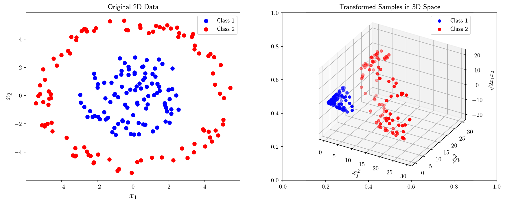
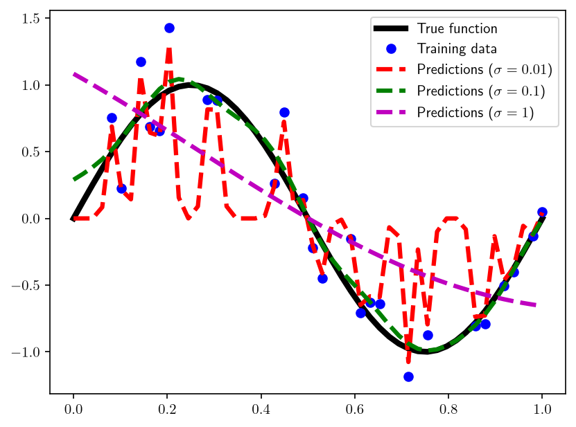

# Transforming the input space

Linear predictors have many desirable properties. They:
  - can be trained by analytical methods,
  - are easy to interpret for humans,
  - are theoretically well understood.

However, their expressiveness is limited. For example, they cannot represent the XOR function. The first solution we presented to improve the expressiveness of linear predictors was to pass them through an activation function and build a network of them. The second is **kernel methods**. The core idea is to transform the input space to another space where the problem can be solved by linear methods. For instance, in classification, we expect from the transformed space that there exists a hyperplane that perfectly separates the classes. This way, nonlinearity is handled by the transformation and all the nice properties of linear predictors are preserved. 

Consider a 2D feature space in which a data point $x = (x_1,x_2) \in \mathbb{R}^2$ belongs to one of two classes: one class is concentrated around the origin in the shape of a sphere and the other surrounds this sphere in the shape of a ring. The data are not linearly separable in the original space. However, if we transform the data to a new space $\phi(x) = (x_1^2, x_2^2, \sqrt{2} x_1 x_2) \in \mathbb{R}^3$, the classes become linearly separable as illustrated below.


```python
import torch as th
import matplotlib.pyplot as plt
from mpl_toolkits.mplot3d import Axes3D

plt.rcParams['text.usetex'] = True # Enable Latex in plots

# Step 1: Generate random samples for two classes
th.manual_seed(0)

# Number of samples for each class
num_samples = 100

# Class 1:
radius1 = 3
theta1 = 2 * th.pi * th.rand(num_samples)
r1 = th.rand(num_samples).sqrt() * radius1
class1_x = r1 * th.cos(theta1)
class1_y = r1 * th.sin(theta1)

# Class 2
radius2 = 5
theta2 = 2 * th.pi * th.rand(num_samples)
r2 = (-0.5 + th.rand(num_samples)) + radius2
class2_x = r2 * th.cos(theta2)
class2_y = r2 * th.sin(theta2)

# Step 2: Define the transformation function to 3D
def transform_to_3d(x, y):
    x_3d = x**2
    y_3d = y**2
    z_3d = (2 ** 0.5) * x * y
    return x_3d, y_3d, z_3d

# Apply the transformation to both classes
class1_x_3d, class1_y_3d, class1_z_3d = transform_to_3d(class1_x, class1_y)
class2_x_3d, class2_y_3d, class2_z_3d = transform_to_3d(class2_x, class2_y)

# Create a figure with two subplots
fig, axes = plt.subplots(1, 2, figsize=(14, 5))

# The classes are not linearly separable in 2D
axes[0].scatter(class1_x, class1_y, label='Class 1', c='b')
axes[0].scatter(class2_x, class2_y, label='Class 2', c='r')
axes[0].set_xlabel('$x_1$', fontsize=14)
axes[0].set_ylabel('$x_2$', fontsize=14)
axes[0].set_title('Original 2D Data')
axes[0].legend(loc='best')

# The classes are linearly separable in 3D after transformation
ax = fig.add_subplot(1, 2, 2, projection='3d', proj_type='ortho')

ax.scatter(class1_x_3d, class1_y_3d, class1_z_3d, label='Class 1', c='b')
ax.scatter(class2_x_3d, class2_y_3d, class2_z_3d, label='Class 2', c='r')
ax.set_xlabel('$x_1^2$', fontsize=14)
ax.set_ylabel('$x_2^2$', fontsize=14)
ax.set_zlabel('$\sqrt{2}  x_1  x_2$')

ax.legend(loc='best')
ax.set_title('Transformed Samples in 3D Space')

plt.show()

```


    

    


# Kernel Trick

In real-world applications, it is not as straightforward to find a suitable transformation space as in the example above, one that would make the problem linearly separable. The best one can often do is to transform the data to a space that is as high dimensional as possible. However, this is computationally expensive. There are attractive mathematical tools that allow us to model the **similarity** of a pair of data points in the transformation space without explicitly computing the representations of these data points in the transformation space. This can be achieved by a special family of functions, called **kernel functions** with certain characteristics. Given an input space $\mathcal{X}$, we would like to have a kernel function $k: \mathcal{X} \times \mathcal{X} \rightarrow \mathbb{R}$ with the following property:

$$
   \begin{aligned}
     k(x_i,x_j) =  \phi(x_i)^\top \phi(x_j).
   \end{aligned}
$$

In words, we would like to design directly the left hand side of the equation above without going through the computational steps of the right hand side. This is called the **kernel trick**. This is possible for only certain types of functions that have specific properties. The following result, due to [Mercer (1909)](https://doi.org/10.1098/rsta.1909.0016)<!-- cite: mercer1909functions | article | author={Mercer, James}; title={Functions of Positive and Negative Type, and Their Connection with the Theory of Integral Equations}; journal={Philosophical Transactions of the Royal Society A}; year={1909}; volume={209}; pages={415--446} -->, gives a necessary and sufficient condition for a function to be a valid kernel function.

**Theorem 11.2.1 (Mercer).** A symmetric function $k: \mathcal{X} \times \mathcal{X} \rightarrow \mathbb{R}$ admits a feature map $\phi$ with $k(x,x') = \phi(x)^\top\phi(x')$ **if and only if** the
Gram matrix it generates (i.e. the matrix generated by evaluating the function on all pairs of data points in an arbitrary data set with $m$ data points)

$$
\begin{aligned}
    K = \begin{bmatrix}
    k(x_1,x_1) & \cdots & k(x_1,x_m) \\
    \vdots & \ddots & \vdots \\
    k(x_m,x_1) & \cdots & k(x_m,x_m)
    \end{bmatrix}
\end{aligned}
$$

is positive semi-definite, i.e. $v^\top K v \geq 0$ for all $v \in \mathbb{R}^m$.

***Proof of the "only if" direction.*** Suppose $k(x,x') = \phi(x)^\top\phi(x')$ for some feature map $\phi$. Then for any $x_1,\ldots,x_m$ and any $v \in \mathbb{R}^m$,

$$v^\top K v = \sum_{i=1}^m\sum_{j=1}^m v_i v_j\, \phi(x_i)^\top \phi(x_j) = \Big\| \sum_{i=1}^m v_i\, \phi(x_i) \Big\|_2^2 \;\geq\; 0,$$

since the double sum is exactly the squared norm of the single vector $\sum_i v_i \phi(x_i)$. Symmetry of $K$ is immediate from symmetry of the inner product $\square$

The converse — that positive semi-definiteness *suffices*, i.e. that some feature map always exists — is the substantial half of the theorem, and it is proved constructively in the section on reproducing kernel Hilbert spaces below (Theorem 11.3.2), where the feature map is built as $\phi(x) := k(x,\cdot)$ and the feature space as a space of functions on $\mathcal{X}$. Until then, the "only if" direction just proved, together with the composition rules below, is already enough to certify every kernel we actually employ.

The most commonly used kernel functions are:

  - **Linear Kernel:** $k(x,y) =  x^\top y$ 
  - **Polynomial Kernel:** $k(x,y) = \left( x^\top y + c \right)^d$
  - **Radial Basis Function (RBF) Kernel:** $k(x,y) = \exp(-\frac{\| x-y \|^2}{2\sigma^2})$
  - **Sigmoid Kernel:** $k(x,y) = \tanh\left( \gamma  x^\top y  + c \right)$

The first three are valid kernels for all parameter values ($c \geq 0$ for the polynomial kernel); this is proved below. The sigmoid kernel, borrowed from neural networks, is **not** positive semi-definite in general: for $c < 0$, $k(0,0) = \tanh(c) < 0$, so already the $1\times1$ Gram matrix of the single point $x = 0$ violates the condition of Theorem 11.2.1.

There also exist kernels that compute the similarity of a pair of graphs, strings, or other complex objects. The nice property of the kernel functions is that one can compute these similarities directly, without needing to define suitable feature spaces for these object types.

One can imagine that it is not straightforward to devise a function that satisfies this condition. However, there are certain rules that allow us to construct new valid kernel functions from existing ones. These rules are called **kernel composition rules**.

**Proposition 11.2.2 (Kernel composition rules).** Let $k_1, k_2, k_3, \ldots$ be valid kernels, $a \in \mathbb{R}^+$ a constant, $B$ a positive semi-definite matrix, and $q: \mathcal{X}\to\mathbb{R}$ any function. Then each of the following is a valid kernel:
  - $k(x,x') = k_1(x,x') + k_2(x,x')$
  - $k(x,x') = a \cdot k_1(x,x')$
  - $k(x,x') = k_1(x,x') \cdot k_2(x,x')$
  - $k(x,x') = x^\top B  x'$
  - $k(x,x') = q(x)\,k_1(x,x')\,q(x')$
  - $k(x,x') = \lim_{n\to\infty} k_n(x,x')$, whenever the limit exists for all $x,x'$.

***Proof.*** By Theorem 11.2.1 it suffices to verify that each rule produces a positive semi-definite Gram matrix. Write $K_1, K_2$ for the Gram matrices of $k_1,k_2$ on an arbitrary sample, both positive semi-definite by hypothesis.

*Sum.* $v^\top(K_1+K_2)v = v^\top K_1 v + v^\top K_2 v \geq 0$.

*Positive scaling.* $v^\top(aK_1)v = a\,(v^\top K_1 v) \geq 0$ since $a > 0$.

*Product.* The Gram matrix of the product kernel is the entrywise (Hadamard) product $K_1 \odot K_2$, and the **Schur product theorem** states that the Hadamard product of two positive semi-definite matrices is positive semi-definite. Directly: write $K_2 = \sum_{r} \lambda_r u_r u_r^\top$ with $\lambda_r \geq 0$ (spectral decomposition of a symmetric positive semi-definite matrix). Then for any $v$,
$$v^\top (K_1 \odot K_2) v = \sum_{i,j} v_i v_j (K_1)_{ij} \sum_r \lambda_r u_{r,i}u_{r,j} = \sum_r \lambda_r \underbrace{\big(v \odot u_r\big)^\top K_1 \big(v \odot u_r\big)}_{\geq\,0} \;\geq\; 0 .$$

*Bilinear form.* Since $B$ is symmetric positive semi-definite, it has a square root $B^{1/2}$ with $B = B^{1/2}B^{1/2}$, so $x^\top B x' = (B^{1/2}x)^\top (B^{1/2}x')$ exhibits the feature map $\phi(x) := B^{1/2}x$ directly.

*Rescaling.* The Gram matrix is $DK_1D$ with $D := \mathrm{diag}(q(x_1),\ldots,q(x_m))$, and $v^\top DK_1Dv = (Dv)^\top K_1(Dv) \geq 0$.

*Limits.* The Gram matrices converge entrywise, so $v^\top Kv = \lim_n v^\top K_nv \geq 0$ $\square$

These rules certify the kernels listed above. The constant kernel $k \equiv 1$ is valid (its Gram matrix $\mathbf{1}\mathbf{1}^\top$ is positive semi-definite), and the polynomial kernel $(x^\top x' + c)^d$ with $c \geq 0$ is built from it and the linear kernel by $d$ applications of the product rule together with the sum rule and positive scaling (expanding the binomial). For the RBF kernel, expand the square in the exponent:
$$\exp\Big(-\frac{\|x-x'\|^2}{2\sigma^2}\Big) = q(x)\,\exp\Big(\frac{x^\top x'}{\sigma^2}\Big)\,q(x'), \qquad q(x) := \exp\Big(-\frac{\|x\|^2}{2\sigma^2}\Big),$$
and $\exp(x^\top x'/\sigma^2) = \lim_{N\to\infty}\sum_{n=0}^N \frac{(x^\top x')^n}{\sigma^{2n}\,n!}$ is a limit of sums of positively scaled powers of the linear kernel. The rescaling and limit rules make it a valid kernel.


# The Reproducing Kernel Hilbert Space

Mercer's theorem guarantees that a positive semi-definite kernel *has* a feature map, but says nothing about which one. There are in general many: the polynomial kernel $(x^\top x')^2$ on $\mathbb{R}^2$ is reproduced by $\phi(x) = (x_1^2, x_2^2, \sqrt2 x_1x_2)$ and equally by any rotation of it. One choice is canonical, and it turns out to be the one that lets us stop talking about $\phi$ altogether and talk instead about a **space of functions** — which is what a hypothesis class is. That space is the RKHS of $k$, following the formulation of [Aronszajn (1950)](https://doi.org/10.1090/S0002-9947-1950-0051437-7)<!-- cite: aronszajn1950theory | article | author={Aronszajn, Nachman}; title={Theory of Reproducing Kernels}; journal={Transactions of the American Mathematical Society}; year={1950}; volume={68}; number={3}; pages={337--404} -->.

**Definition 11.3.1 (Reproducing kernel Hilbert space).** A **reproducing kernel Hilbert space (RKHS)** for a kernel $k$ on $\mathcal{X}$ is a Hilbert space $\mathcal{H}_k$ of functions $f: \mathcal{X}\to\mathbb{R}$, with inner product $\langle\cdot,\cdot\rangle_{\mathcal{H}_k}$ and induced norm $\|f\|_{\mathcal{H}_k} := \sqrt{\langle f,f\rangle_{\mathcal{H}_k}}$, such that

1. $k(x,\cdot) \in \mathcal{H}_k$ for every $x \in \mathcal{X}$, and
2. (**reproducing property**) $\langle f, k(x,\cdot)\rangle_{\mathcal{H}_k} = f(x)$ for every $f \in \mathcal{H}_k$ and every $x \in \mathcal{X}$.

The reproducing property is the whole point: it says that *evaluating* a function at a point is the same operation as taking an inner product against a fixed element of the space. Applying it twice with $f = k(x',\cdot)$ gives

$$\langle k(x,\cdot),\, k(x',\cdot)\rangle_{\mathcal{H}_k} = k(x,x'),$$

so $\phi(x) := k(x,\cdot)$ is a feature map for $k$ — the **canonical feature map** — whose feature space is $\mathcal{H}_k$ itself. Every function in $\mathcal{H}_k$ is simultaneously a hypothesis and a point of the feature space.

---

**Theorem 11.3.2 (Moore-Aronszajn).** Every positive semi-definite kernel $k$ has exactly one RKHS.

***Proof.*** *Step 1: a pre-Hilbert space.* Start from the linear span of the kernel sections,

$$\mathcal{V} := \Big\{ f = \sum_{i=1}^n a_i\, k(x_i,\cdot) \;:\; n \in \mathbb{N},\ a_i \in \mathbb{R},\ x_i \in \mathcal{X} \Big\},$$

and define, for $f = \sum_i a_i k(x_i,\cdot)$ and $g = \sum_j b_j k(x_j',\cdot)$,

$$\langle f, g\rangle_{\mathcal{V}} := \sum_{i=1}^n\sum_{j=1}^{n'} a_i b_j\, k(x_i, x_j'). \tag{11.1}$$

*Well defined.* The right-hand side of (11.1) refers to the coefficients $a_i$ and points $x_i$, which are not unique for a given $f$. But rewriting it two ways,

$$\sum_{i,j} a_i b_j k(x_i,x_j') = \sum_{j=1}^{n'} b_j\, f(x_j') = \sum_{i=1}^{n} a_i\, g(x_i),$$

exhibits it once as a quantity depending on $f$ only through its *values*, and once as a quantity depending on $g$ only through its values. Hence it does not depend on either representation.

*Inner product.* Bilinearity is immediate from (11.1) and symmetry from $k(x,x')=k(x',x)$. For positive semi-definiteness, $\langle f,f\rangle_{\mathcal{V}} = \sum_{i,j}a_ia_jk(x_i,x_j) = a^\top K a \geq 0$, which is exactly the Gram-matrix condition of Theorem 11.2.1 — this is the *only* place the assumption on $k$ is used, and it is used in full.

*Reproducing property.* Taking $g = k(x,\cdot)$ (i.e. $n'=1$, $b_1=1$, $x_1'=x$) in (11.1) gives $\langle f, k(x,\cdot)\rangle_{\mathcal{V}} = \sum_i a_i k(x_i,x) = f(x)$.

*Definiteness.* We must still rule out a non-zero $f$ with $\|f\|_{\mathcal{V}} = 0$. The Cauchy-Schwarz inequality holds for any positive semi-definite bilinear form, so combining it with the reproducing property, for every $x$,

$$|f(x)| = \big|\langle f, k(x,\cdot)\rangle_{\mathcal{V}}\big| \;\leq\; \|f\|_{\mathcal{V}}\,\|k(x,\cdot)\|_{\mathcal{V}} = \|f\|_{\mathcal{V}}\sqrt{k(x,x)}. \tag{11.2}$$

If $\|f\|_{\mathcal{V}}=0$ then $f(x)=0$ for every $x$, i.e. $f$ is the zero *function*. So $\langle\cdot,\cdot\rangle_{\mathcal{V}}$ is a genuine inner product on $\mathcal{V}$, and $(\mathcal{V}, \langle\cdot,\cdot\rangle_{\mathcal{V}})$ is a pre-Hilbert space satisfying both conditions of Definition 11.3.1.

*Step 2: completion.* By (11.2), a sequence $(f_n)$ that is Cauchy in $\|\cdot\|_{\mathcal{V}}$ is Cauchy pointwise, $|f_n(x) - f_k(x)| \leq \|f_n - f_k\|_{\mathcal{V}}\sqrt{k(x,x)}$, so it has a pointwise limit. Let $\mathcal{H}_k$ be the set of all functions on $\mathcal{X}$ that arise as pointwise limits of Cauchy sequences in $\mathcal{V}$. It contains $\mathcal{V}$ (constant sequences). The construction rests on one observation:

> *If $(f_n)$ is Cauchy in $\mathcal{V}$ and $f_n \to 0$ pointwise, then $\|f_n\|_{\mathcal{V}} \to 0$.* Indeed, a Cauchy sequence is bounded, $\|f_n\|_{\mathcal{V}} \leq C$. Given $\epsilon > 0$ pick $N$ with $\|f_n - f_N\|_{\mathcal{V}} \leq \epsilon$ for $n \geq N$, and write $f_N = \sum_i a_i k(x_i,\cdot)$. Then $\|f_n\|_{\mathcal{V}}^2 = \langle f_n, f_n - f_N\rangle_{\mathcal{V}} + \langle f_n, f_N\rangle_{\mathcal{V}} \leq C\epsilon + \big|\sum_i a_i f_n(x_i)\big|$ by Cauchy-Schwarz and the reproducing property, and the finite sum tends to $0$. So $\limsup_n\|f_n\|_{\mathcal{V}}^2 \leq C\epsilon$ for every $\epsilon$.

For $f,g \in \mathcal{H}_k$ with approximating sequences $(f_n), (g_n)$ define $\langle f,g\rangle_{\mathcal{H}_k} := \lim_n\langle f_n,g_n\rangle_{\mathcal{V}}$. The limit exists, since $|\langle f_n,g_n\rangle - \langle f_k,g_k\rangle| \leq \|f_n - f_k\|\,\|g_n\| + \|f_k\|\,\|g_n - g_k\|$ makes the sequence Cauchy in $\mathbb{R}$. It does not depend on the chosen sequences: if $(f_n')$ also converges pointwise to $f$, then $(f_n - f_n')$ is Cauchy and tends to $0$ pointwise, hence to $0$ in norm by the observation, and the same estimate shows the limits agree. The form is bilinear, symmetric and non-negative, inheriting these from $\langle\cdot,\cdot\rangle_{\mathcal{V}}$, and it extends $\langle\cdot,\cdot\rangle_{\mathcal{V}}$. It is definite: if $\langle f,f\rangle_{\mathcal{H}_k} = 0$ then $\|f_n\|_{\mathcal{V}} \to 0$, so $f(x) = \lim_n f_n(x) = 0$ for every $x$ by (11.2).

*Step 3: reproducing property and completeness.* For $f \in \mathcal{H}_k$, $\langle f, k(x,\cdot)\rangle_{\mathcal{H}_k} = \lim_n\langle f_n, k(x,\cdot)\rangle_{\mathcal{V}} = \lim_n f_n(x) = f(x)$. Moreover $\|f - f_n\|_{\mathcal{H}_k}^2 = \lim_k\|f_k - f_n\|_{\mathcal{V}}^2 \leq \sup_{k \geq n}\|f_k - f_n\|_{\mathcal{V}}^2 \to 0$, so $\mathcal{V}$ is dense in $\mathcal{H}_k$. Now let $(h_j)$ be Cauchy in $\mathcal{H}_k$, and choose $f_j \in \mathcal{V}$ with $\|h_j - f_j\|_{\mathcal{H}_k} \leq 1/j$. Then $(f_j)$ is Cauchy in $\mathcal{V}$; its pointwise limit $h$ lies in $\mathcal{H}_k$, with $\|h - f_j\|_{\mathcal{H}_k} \to 0$ by the density argument, hence $\|h - h_j\|_{\mathcal{H}_k} \leq \|h - f_j\|_{\mathcal{H}_k} + 1/j \to 0$. So $\mathcal{H}_k$ is a Hilbert space satisfying Definition 11.3.1.

*Step 4: uniqueness.* Let $\mathcal{G}$ be any RKHS for $k$. By the reproducing property and bilinearity, $\mathcal{G}$ contains $\mathcal{V}$ with the same inner product. A Cauchy sequence $(f_n)$ in $\mathcal{V}$ converges in the complete space $\mathcal{G}$, and convergence in $\mathcal{G}$ implies pointwise convergence (by (11.2), valid in any RKHS), so its limit in $\mathcal{G}$ is its pointwise limit. Hence $\mathcal{H}_k \subseteq \mathcal{G}$, with the same inner product, and $\mathcal{H}_k$ is a closed subspace of $\mathcal{G}$, being complete. If it were a proper subspace, the projection theorem would give a non-zero $g \in \mathcal{G}$ orthogonal to $\mathcal{H}_k$, and then $g(x) = \langle g, k(x,\cdot)\rangle_{\mathcal{G}} = 0$ for every $x$, a contradiction. So $\mathcal{G} = \mathcal{H}_k$ $\square$

Two consequences are worth recording immediately. First, the construction **completes the proof of Mercer's theorem**: the converse direction we deferred in Theorem 11.2.1 is exactly the statement that a positive semi-definite $k$ admits a feature map, and $\phi(x) := k(x,\cdot)$ into $\mathcal{H}_k$ is one. Second, every element of $\mathcal{H}_k$ is a limit, in norm and pointwise, of finite kernel expansions $\sum_i a_i k(x_i,\cdot)$ — so the hypothesis class generated by a kernel is precisely the closure of the set of weighted similarity scores to a finite set of points. This is the formal content of the informal description of kernel methods as "predicting by weighted similarity to remembered examples".

---

**Proposition 11.3.3 (The RKHS norm controls the function).** For every $f \in \mathcal{H}_k$ and every $x \in \mathcal{X}$, $|f(x)| \leq \|f\|_{\mathcal{H}_k}\sqrt{k(x,x)}$. In particular, if $k(x,x) \leq R^2$ uniformly, then $\sup_x|f(x)| \leq R\|f\|_{\mathcal{H}_k}$.

***Proof.*** This is (11.2), which used only the reproducing property and Cauchy-Schwarz, both available in $\mathcal{H}_k$ $\square$

Proposition 11.3.3 is the reason $\|\cdot\|_{\mathcal{H}_k}$ is the right complexity measure for kernel methods, and it identifies the hypothesis class of the generalization section below: for a linear predictor $x \mapsto w^\top\phi(x)$ written in the canonical feature map, $w$ *is* a function $f \in \mathcal{H}_k$ and $\|w\|_2$ *is* $\|f\|_{\mathcal{H}_k}$, so

$$\mathcal{H}_B \;=\; \big\{ f \in \mathcal{H}_k : \|f\|_{\mathcal{H}_k} \leq B \big\}$$

is a class of uniformly bounded functions, whatever the dimension of the feature space happens to be. That is precisely the norm-constrained, dimension-free regime that Theorem 7.3.6 was built for.

**What the norm measures.** For the RBF kernel the RKHS norm penalizes wiggliness: one can show that $\|f\|^2_{\mathcal{H}_k}$ equals a weighted integral of $|\widehat f(\omega)|^2$ against $e^{\sigma^2\|\omega\|^2/2}$ over the frequency domain, so high-frequency components are charged exponentially, the more so the larger $\sigma$ is (see [Girosi, Jones & Poggio (1995)](https://doi.org/10.1162/neco.1995.7.2.219)<!-- cite: girosi1995regularization | article | author={Girosi, Federico and Jones, Michael and Poggio, Tomaso}; title={Regularization Theory and Neural Networks Architectures}; journal={Neural Computation}; year={1995}; volume={7}; number={2}; pages={219--269} --> for this Fourier-domain description of the norm). This makes the bandwidth $\sigma$ and the regularization coefficient $\lambda$ two different dials on the same quantity — $\sigma$ decides *which* functions are expensive, $\lambda$ decides *how much* we are willing to pay — and explains, before any experiment, why the fits below vary so sharply with $\sigma$.

---

## The Representer Theorem

The RKHS is typically infinite-dimensional, so minimizing an objective over all of $\mathcal{H}_k$ looks like an infinite-dimensional optimization problem. It is not: the solution is always a finite kernel expansion on the training inputs, with one coefficient per training example. This is the single result that makes kernel methods computable, due to [Kimeldorf & Wahba (1971)](https://doi.org/10.1016/0022-247X(71)90184-3)<!-- cite: kimeldorf1971representer | article | author={Kimeldorf, George S. and Wahba, Grace}; title={Some Results on Tchebycheffian Spline Functions}; journal={Journal of Mathematical Analysis and Applications}; year={1971}; volume={33}; number={1}; pages={82--95} -->.

**Theorem 11.3.4 (Representer theorem).** Let $S = \{(x_i,y_i)\}_{i=1}^m$, let $\Psi: \mathbb{R}^m \to \mathbb{R}$ be an arbitrary function of the $m$ predicted values (a "data-fit" term), and let $\mathrm{pen}: [0,\infty) \to \mathbb{R}$ be a **strictly increasing** regularizer, in the sense of Chapter 3. Then every minimizer $f^*$ of

$$\min_{f \in \mathcal{H}_k}\ \Psi\big(f(x_1),\ldots,f(x_m)\big) + \mathrm{pen}\big(\|f\|_{\mathcal{H}_k}\big)$$

admits a representation

$$\begin{gathered}
f^*(\cdot) = \sum_{i=1}^m a_i\, k(x_i,\cdot), \\
a \in \mathbb{R}^m.
\end{gathered}$$

***Proof.*** Let $\mathcal{V}_S := \mathrm{span}\{k(x_1,\cdot),\ldots,k(x_m,\cdot)\} \subseteq \mathcal{H}_k$, a finite-dimensional and therefore closed subspace, and decompose any $f \in \mathcal{H}_k$ orthogonally as

$$\begin{gathered}
f = f_\parallel + f_\perp, \\
f_\parallel \in \mathcal{V}_S,\ \ f_\perp \perp \mathcal{V}_S .
\end{gathered}$$

*The data-fit term $\Psi$ cannot see $f_\perp$.* By the reproducing property, for every training input $x_j$,

$$f(x_j) = \langle f, k(x_j,\cdot)\rangle_{\mathcal{H}_k} = \langle f_\parallel, k(x_j,\cdot)\rangle_{\mathcal{H}_k} + \underbrace{\langle f_\perp, k(x_j,\cdot)\rangle_{\mathcal{H}_k}}_{=\,0,\ \text{since } k(x_j,\cdot) \in \mathcal{V}_S} = f_\parallel(x_j),$$

so $\Psi(f(x_1),\ldots,f(x_m)) = \Psi(f_\parallel(x_1),\ldots,f_\parallel(x_m))$ exactly.

*The regularizer can only be hurt by $f_\perp$.* By the Pythagorean identity in a Hilbert space,

$$\|f\|^2_{\mathcal{H}_k} = \|f_\parallel\|^2_{\mathcal{H}_k} + \|f_\perp\|^2_{\mathcal{H}_k} \;\geq\; \|f_\parallel\|^2_{\mathcal{H}_k},$$

with equality if and only if $f_\perp = 0$. Since $\mathrm{pen}$ is strictly increasing, $\mathrm{pen}(\|f\|_{\mathcal{H}_k}) \geq \mathrm{pen}(\|f_\parallel\|_{\mathcal{H}_k})$, strictly so unless $f_\perp = 0$.

Adding the two, the objective at $f_\parallel$ is no larger than at $f$, and is **strictly** smaller whenever $f_\perp \neq 0$. A minimizer therefore has $f^*_\perp = 0$, i.e. $f^* = f^*_\parallel \in \mathcal{V}_S$, which is the claimed form $\square$

Read the proof again for what it does *not* assume. Nothing about $\Psi$: it may be built from the squared loss, the hinge loss of an SVM, the logistic loss, or a non-convex loss with many minima; it need not even be continuous, and it need not decompose across examples at all. The theorem is driven entirely by the reproducing property (which makes $\Psi$ blind to $f_\perp$) and by orthogonality (which makes $\mathrm{pen}$ charge for $f_\perp$ without any compensating benefit). What *is* essential is that the regularizer be a strictly increasing function of the RKHS norm specifically — this is why kernel methods regularize with $\|f\|_{\mathcal{H}_k}$ and not with something else.

---

**Corollary 11.3.5 (Kernel ridge regression).** Take $\Psi(u_1,\ldots,u_m) := \sum_{i=1}^m (y_i - u_i)^2$ and $\mathrm{pen}(t) := \lambda t^2$ with $\lambda > 0$. Then the minimizer over $\mathcal{H}_k$ is $f^*(\cdot) = \sum_i a_i k(x_i,\cdot)$ with

$$a = (K + \lambda I)^{-1} y .$$

***Proof.*** By Theorem 11.3.4 we may restrict the search to $f = \sum_i a_i k(x_i,\cdot)$, at which point the reproducing property and (11.1) evaluate both terms in terms of the Gram matrix alone:

$$\begin{gathered}
f(x_j) = \sum_i a_i k(x_i,x_j) = (Ka)_j, \\
\|f\|^2_{\mathcal{H}_k} = \sum_{i,j}a_ia_j k(x_i,x_j) = a^\top K a .
\end{gathered}$$

The infinite-dimensional problem has become the $m$-dimensional one

$$\min_{a \in \mathbb{R}^m}\ \|y - Ka\|_2^2 + \lambda\, a^\top K a,$$

whose gradient is $-2Ky + 2KKa + 2\lambda K a = 2K\big[(K+\lambda I)a - y\big]$. Setting it to zero is solved by $(K+\lambda I)a = y$, and $K + \lambda I \succ 0$ for $\lambda>0$ makes that system uniquely solvable $\square$

This is exactly the solution the dual derivation of the following section arrives at, and exactly what `precompute_a` computes in the implementation below — but obtained without ever mentioning $\phi$, $\Phi$ or $w$. The dual derivation has to *discover* that $w$ lies in the span of the training features, by inspecting the stationarity condition of one particular objective; the representer theorem says it in advance, for every objective of that shape. The practical readings are:

* **Cost.** Training is $O(m^3)$ (one linear solve) and prediction $O(m)$ per query, *independent of the dimension of the feature space* — including when that dimension is infinite, as for the RBF kernel. What is traded away is a cost that grows with the sample size instead, which is the precise sense in which kernel methods are "non-parametric": the model that must be stored is the training set itself.
* **Where the guarantee comes from.** The trained predictor satisfies $\|f^*\|_{\mathcal{H}_k}^2 = a^\top K a \leq \|y\|_2^2/\lambda$ by comparing the objective at $f^*$ against the candidate $f = 0$, so $\lambda$ directly caps the RKHS norm — hence, via Proposition 11.3.3 and Theorem 7.3.6, the Rademacher complexity of the class the solution came from. The section on generalization below makes this quantitative.

# Kernel regression

Let us remember the linear methods. It is possible to apply the kernel trick to all of them, i.e. to **kernelize** them. Let us take **ridge regression** as an example. Consider the case where the raw inputs $x_i$ are passed through a feature extraction step $\phi(x_i)$. Call the matrix that contains $\phi(x_i)^\top$ in its rows $\Phi \in \mathbb{R}^{m \times d}$. The ridge regression objective can then be expressed as

$$
\begin{aligned}
    \mathcal{L}(w) &= \sum_{i=1}^m (y_i - w^\top \phi(x_i))^2 + \lambda ||w||_2^2\\
      &= y^\top y - 2y^\top \Phi w + w^\top \Phi^\top \Phi w + \lambda w^\top w,
\end{aligned}
$$

where $y \in \mathbb{R}^m$ is the target vector and $w \in \mathbb{R}^d$ is the weight vector. We perform learning by minimizing this objective with respect to the weights:

$$
\begin{aligned}
  \nabla_{w} \mathcal{L}(w) &= -2\Phi^\top y + 2\Phi^\top \Phi w + 2\lambda w \triangleq 0 \\
    &\Rightarrow (\Phi^\top \Phi + \lambda I) w = \Phi^\top y \\
    &\Rightarrow w = (\Phi^\top \Phi + \lambda I)^{-1} \Phi^\top y.
\end{aligned}
$$

This primal solution still requires inverting a $d \times d$ matrix and computing $\phi(\cdot)$ explicitly, both of which can be prohibitive when $\phi$ maps into a very high (or infinite) dimensional space. Since the gradient stationarity condition $\Phi^\top \Phi w + \lambda w = \Phi^\top y$ implies $w = \frac{1}{\lambda}\Phi^\top(y - \Phi w)$, the optimal $w$ always lies in the span of the training feature vectors $\phi(x_1), \ldots, \phi(x_m)$. We can therefore reparametrize it as

$$
\begin{aligned}
  w = \Phi^\top a, \qquad a \in \mathbb{R}^m,
\end{aligned}
$$

and search for the optimal $a$ instead. Placing this expression into the objective gives its so-called **dual representation**, which contains the data only through inner products in the transformed space:

$$
\begin{aligned}
      \mathcal{L}(a) &= y^\top y - 2y^\top \Phi \Phi^\top a + a^\top \Phi \Phi^\top \Phi \Phi^\top a + \lambda a^\top \Phi \Phi^\top a.
\end{aligned}
$$

Note that $K := \Phi \Phi^\top$ is the $m \times m$ dimensional **Gram** matrix with $K_{ij} = \phi(x_i)^\top \phi(x_j)$. This inner product can be replaced by any kernel function, generating a Gram matrix with entries $K_{ij} = k(x_i,x_j)$. The kernelized objective then reads

$$
\begin{aligned}
 \mathcal{L}(a) = y^\top y - 2y^\top K a + a^\top K K a + \lambda a^\top K a.
\end{aligned}
$$

Setting the gradient of $\mathcal{L}$ with respect to $a$ to zero and solving for $a$ gives

$$
 \begin{aligned}
 \nabla_{a} \mathcal{L}(a) &= -2 K y + 2 K K a + 2 \lambda K a \triangleq 0 \\
 \Rightarrow & K \big[ (K + \lambda I) a - y \big] = 0 \\
 \Rightarrow & a = (K+\lambda I)^{-1} y,
\end{aligned}
$$

where the last step assumes $K$ is invertible (it always is a valid solution regardless, since any $a$ satisfying $(K+\lambda I)a = y$ also solves $K\big[(K+\lambda I)a - y\big]=0$).

To reiterate, we first redefined the parameters $w$ by an expression that involves a newly introduced variable $a$, and then found the optimal value for this variable that minimizes the training loss. The resulting objective does not have any trainable parameters left that are not summarized by the Gram matrix $K$. Furthermore, the optimal value of $a$ requires generating a Gram matrix using the whole training set, and it appears as an intermediate result in the calculation of the prediction function. We predict the label $y_*$ of a query input $x_*$ by

$$
\begin{aligned}
    f(x_*) &= \phi(x_*)^\top w = \phi(x_*)^\top \Phi^\top a \\
        &= k_*^\top (K+\lambda I)^{-1} y,
\end{aligned}
$$

where

$$
\begin{aligned}
    k_* = \begin{bmatrix}
             k(x_*, x_1)\\
             k(x_*, x_2)\\
             \vdots,\\
             k(x_*, x_m)
          \end{bmatrix}.   
\end{aligned}
$$

Because the prediction function requires computations on the whole training set, kernel regression is called a **lazy learner**: unlike the models we have seen so far, it does all of its work at prediction time, not at training time (the k-nearest neighbor approach of Chapter 4 is the other example — "training" there consists only of memorizing the data set). It is also a **non-parametric** method. As seen in the example implementation given below, its "predict" function takes the whole training set as an input in order to calculate the $k_*$ vector.

A major weakness of the kernel methods is that many common kernel functions have tunable hyperparameters. For instance, the RBF kernel has a hyperparameter $\sigma$ that controls the length scale of the kernel — and, as the RKHS reading above showed, thereby decides how expensive high-frequency components are in $\|f\|_{\mathcal{H}_k}$. The performance of the model is sensitive to the choice of this hyperparameter. The example below performs kernel regression with three different choices of $\sigma$, each giving dramatically different outcomes. While $\sigma=0.1$ gives a reasonable fit, $\sigma=0.01$ **overfits** — the kernel sections are so narrow that the fit spikes at each training point and returns to zero between them — and $\sigma=1$ **underfits**, since at that length scale the RKHS charges so much for curvature that the fit cannot follow a full period of the sine.


```python
import matplotlib.pyplot as plt
import torch as th

th.manual_seed(6)

# Generate the data
inputs = th.linspace(0, 1, 50, dtype=th.float64).unsqueeze(1)
outputs = th.sin(2 * th.pi * inputs)
labels = outputs + th.randn(inputs.shape, dtype=th.float64) * 0.25

num_samples = inputs.shape[0]
num_train_samples = num_samples // 2

idx = th.randperm(num_samples)
inputs_train = inputs[idx[:num_train_samples]]
labels_train = labels[idx[:num_train_samples]]

class KernelLinearRegression:
    def __init__(self, lambda_reg=0.1, length_scale=0.1):
        self.lambda_reg = lambda_reg
        self.sigma = length_scale

    def compute_rbf_kernel(self, X, Xp):
        # k(x,x') = exp(-||x-x'||^2 / (2 sigma^2))
        dist = th.cdist(X, Xp)
        return th.exp(-dist**2 / (2 * self.sigma**2))

    def precompute_a(self, inputs_train, labels_train):
        # a = (K + lambda I)^{-1} y, solved as the linear system
        # (K + lambda I) a = y
        K = self.compute_rbf_kernel(inputs_train, inputs_train)
        A = K + self.lambda_reg * th.eye(inputs_train.shape[0], dtype=K.dtype)
        self.a = th.linalg.solve(A, labels_train)

    def predict(self, inputs_train, inputs):
        # h(x) = sum_i a_i k(x_i, x)
        Kp = self.compute_rbf_kernel(inputs_train, inputs)
        return Kp.T @ self.a

# Create three models with different kernel hyperparameters
model1 = KernelLinearRegression(length_scale=0.01)
model1.precompute_a(inputs_train, labels_train)

model2 = KernelLinearRegression(length_scale=0.1)
model2.precompute_a(inputs_train, labels_train)

model3 = KernelLinearRegression(length_scale=1)
model3.precompute_a(inputs_train, labels_train)

# This is a "nonparametric model", so
#   i)  There is no "learn" function. "precompute_a" only
#       computes a value that is reused across different predictions
#   ii) Predict function takes the training data as input

predictions1 = model1.predict(inputs_train, inputs)
predictions2 = model2.predict(inputs_train, inputs)
predictions3 = model3.predict(inputs_train, inputs)

plt.plot(inputs, outputs, 'k-',
         label="True function", linewidth=4)
plt.plot(inputs_train, labels_train, 'bo',
         label="Training data")
plt.plot(inputs, predictions1, 'r--',
         label=r"Predictions ($\sigma=0.01$)", linewidth=3)
plt.plot(inputs, predictions2, 'g--',
         label=r"Predictions ($\sigma=0.1$)", linewidth=3)
plt.plot(inputs, predictions3, 'm--',
         label=r"Predictions ($\sigma=1$)", linewidth=3)
plt.legend(loc="upper right")
plt.show()
```


    

    


## Generalization of Kernel Methods

Kernel methods look, at first glance, like exactly the setting Theorem 7.3.6 warned us about: the feature map $\phi(x)$ can live in an arbitrarily high — even infinite — dimensional space (the RBF kernel above is a standard example), for which $d_{VC}$ is typically infinite, making the VC-dimension bounds of Chapter 6 vacuous. But Theorem 7.3.6 already told us this does not matter: for a norm-constrained linear predictor $x \mapsto w^\top \phi(x)$ with $\|w\|_2 \leq B$, the Rademacher complexity is $BR/\sqrt m$, where $R$ bounds $\|\phi(x)\|_2$ — with **no dependence on the dimension of $\phi(x)$ at all**. This is precisely the regime kernel methods create by design, and in the canonical feature map of Definition 11.3.1 the constrained class is exactly the RKHS ball $\mathcal{H}_B = \{f \in \mathcal{H}_k : \|f\|_{\mathcal{H}_k} \leq B\}$ of Proposition 11.3.3.

We can, in fact, do slightly better and eliminate $\phi$ from the bound entirely, expressing it purely in terms of the kernel — a small derivation worth doing explicitly, since it shows the kernel trick paying off even inside the generalization theory itself, not only inside the training algorithm. Let $\mathcal{H}_B := \{x \mapsto w^\top \phi(x) : \|w\|_2 \leq B\}$. Since $\|\phi(x)\|_2^2 = \phi(x)^\top\phi(x) = k(x,x)$,

$$
\begin{aligned}
\widehat{\mathfrak{R}}_S(\mathcal{H}_B) = \frac{B}{m}\, \mathbb{E}_\sigma\Big[\Big\|\sum_{i=1}^m \sigma_i \phi(x_i)\Big\|_2\Big] &\leq \frac{B}{m}\sqrt{\mathbb{E}_\sigma\Big[\Big\|\sum_i \sigma_i \phi(x_i)\Big\|_2^2\Big]} \\
&= \frac{B}{m}\sqrt{\sum_{i=1}^m \|\phi(x_i)\|_2^2} = \frac{B}{m}\sqrt{\sum_{i=1}^m k(x_i,x_i)} = \frac{B\sqrt{\mathrm{tr}(K)}}{m},
\end{aligned}
$$

using Jensen's inequality and $\mathbb{E}[\sigma_i\sigma_{i'}]=0$ for $i \neq i'$ (exactly as in the proof of Theorem 7.3.6), where $K$ is the Gram matrix of Mercer's theorem. This **trace bound** is computable directly from the kernel matrix — never requiring $\phi$ to be written down — and is always at least as tight as the generic $BR/\sqrt m$ bound, since $\mathrm{tr}(K) = \sum_i k(x_i,x_i) \leq mR^2$ whenever $k(x,x)\leq R^2$ uniformly.

This connects directly to the regularization coefficient $\lambda$. Write kernel ridge regression in the averaged form
$$\widehat f_S := \arg\min_{f\in\mathcal{H}_k}\ \mathcal{J}_S(f), \qquad \mathcal{J}_S(f) := \frac1m\sum_{i=1}^m\big(y_i - f(x_i)\big)^2 + \lambda\|f\|^2_{\mathcal{H}_k},$$
which is the objective of Corollary 11.3.5 with its $\lambda$ replaced by $m\lambda$, and assume $|y| \leq Y$ and $k(x,x) \leq R^2$. Comparing the minimizer with $f = 0$ gives $\lambda\|\widehat f_S\|^2_{\mathcal{H}_k} \leq \mathcal{J}_S(\widehat f_S) \leq \mathcal{J}_S(0) \leq Y^2$, so
$$\|\widehat f_S\|_{\mathcal{H}_k} \;\leq\; \frac{Y}{\sqrt\lambda} =: B(\lambda)$$
for **every** sample. The solution therefore always comes from the class $\mathcal{H}_{B(\lambda)}$, which is fixed before the data are seen, so Theorem 7.3.2 applies to it, and the trace bound gives $\widehat{\mathfrak{R}}_S(\mathcal{H}_{B(\lambda)}) \leq \frac{YR}{\sqrt{\lambda m}}$. This makes quantitative what Chapter 3 promised only qualitatively when it introduced ridge regression as an instance of Structural Risk Minimization: increasing $\lambda$ shrinks the class the solution can come from, and with it the complexity term of the generalization bound.

The same regularization also makes the algorithm stable, which gives a faster rate in expectation:

**Corollary 11.4.1 (Kernel ridge regression is uniformly stable).** Under the assumptions above, with the squared loss $\phi(f,(x,y)) = (y - f(x))^2$,
$$\mathbb{E}_S\big[R(\widehat f_S)\big] \;\leq\; \mathbb{E}_S\big[\widehat{R}_S(\widehat f_S)\big] + \frac{4R^2Y^2\big(1 + R/\sqrt\lambda\big)^2}{\lambda m}.$$

***Proof.*** Since every minimizer lies in the closed convex ball $\Omega := \{f : \|f\|_{\mathcal{H}_k} \leq Y/\sqrt\lambda\}$, $\widehat f_S$ is also the minimizer of $\mathcal{J}_S$ over $\Omega$. By the reproducing property $f(x) = \langle f, k(x,\cdot)\rangle_{\mathcal{H}_k}$, so the loss is a convex function of $f$ with gradient $-2(y - f(x))\,k(x,\cdot)$, whose norm on $\Omega$ is at most $2(Y + RY/\sqrt\lambda)R =: G$ by Proposition 11.3.3; the loss is therefore $G$-Lipschitz on $\Omega$. The regularizer $\lambda\|f\|^2_{\mathcal{H}_k}$ is $2\lambda$-strongly convex. Theorem 7.8.3, whose proof holds verbatim in a Hilbert space, makes the algorithm $\frac{2G^2}{2\lambda m}$-uniformly stable, and Theorem 7.8.2 concludes $\square$

The Rademacher route gives a gap of order $1/\sqrt{\lambda m}$ with high probability; the stability route gives order $1/(\lambda m)$ in expectation. Both say that a larger $\lambda$ produces a smaller gap, and the price is paid in the training error.

How small can the training error, and more importantly the approximation error, become as $\lambda \to 0$, i.e. as the norm budget $B$ grows? For the RBF kernel the answer is: as small as for any continuous predictor.

**Theorem 11.4.2 (The RBF kernel is universal).** Let $k$ be the RBF kernel with bandwidth $\sigma > 0$ on $\mathbb{R}^d$ and $\mathcal{X} \subset \mathbb{R}^d$ compact. For every continuous $g: \mathcal{X} \to \mathbb{R}$ and every $\epsilon > 0$ there is a finite kernel expansion $f = \sum_{i=1}^n a_ik(x_i,\cdot)$, $x_i \in \mathbb{R}^d$, with $\sup_{x\in\mathcal{X}}|f(x) - g(x)| \leq \epsilon$.

***Proof.*** Let $\mathcal{C}$ be the closure, in the supremum norm on $\mathcal{X}$, of the span of the kernel sections $k(y,\cdot)$, $y \in \mathbb{R}^d$; it is a closed linear subspace of the continuous functions on $\mathcal{X}$, and the claim is that it contains every continuous $g$. (The kernel and its RKHS are defined on all of $\mathbb{R}^d$, and the centres range over $\mathbb{R}^d$; the approximation is required only on $\mathcal{X}$.) With $q(x) := e^{-\|x\|^2/(2\sigma^2)}$ as above, $k(y,x) = q(y)\,q(x)\,e^{y^\top x/\sigma^2}$, so $\mathcal{C}$ contains the functions $x \mapsto q(x)e^{y^\top x/\sigma^2}$ for every $y$.

*Step 1: polynomials times $q$.* We show by induction on the degree that $\mathcal{C}$ contains $x \mapsto q(x)\,p(x)\,e^{y^\top x/\sigma^2}$ for every monomial $p(x) = x_1^{\alpha_1}\cdots x_d^{\alpha_d}$ and every $y$. Degree $0$ is the observation above. If it holds for $p$, consider the difference quotients
$$D_h(x) := q(x)\,p(x)\,\frac{e^{(y + he_j)^\top x/\sigma^2} - e^{y^\top x/\sigma^2}}{h} \;\in\; \mathcal{C}, \qquad h \neq 0,$$
with $e_j$ the $j$-th unit vector. With $u := hx_j/\sigma^2$, $\big|\frac{e^u - 1}{h} - \frac{x_j}{\sigma^2}\big| = \frac{|e^u - 1 - u|}{|h|} \leq \frac{u^2e^{|u|}}{2|h|} = \frac{|h|\,x_j^2}{2\sigma^4}e^{|h x_j|/\sigma^2}$, which tends to $0$ uniformly on the compact $\mathcal{X}$ as $h \to 0$; the remaining factor $q\,p\,e^{y^\top x/\sigma^2}$ is bounded there. So $D_h \to q\,p\,\frac{x_j}{\sigma^2}\,e^{y^\top x/\sigma^2}$ uniformly, and $\mathcal{C}$, being closed, contains the limit. Taking $y = 0$, $\mathcal{C}$ contains $q\,p$ for every polynomial $p$.

*Step 2: Weierstrass.* The function $g/q$ is continuous on $\mathcal{X}$, so by the Weierstrass approximation theorem (in its multivariate form) there is a polynomial $p$ with $\sup_{\mathcal{X}}|g/q - p| \leq \epsilon$. Since $0 < q \leq 1$, $\sup_{\mathcal{X}}|g - q\,p| \leq \epsilon$, and $q\,p \in \mathcal{C}$. By the definition of the closure there is a finite kernel expansion within $\epsilon$ of $q\,p$, hence within $2\epsilon$ of $g$; as $\epsilon$ was arbitrary, this proves the claim $\square$

Kernels with this property are called **universal**; see [Steinwart (2001)](https://www.jmlr.org/papers/v2/steinwart01a.html)<!-- cite: steinwart2001influence | article | author={Steinwart, Ingo}; title={On the Influence of the Kernel on the Consistency of Support Vector Machines}; journal={Journal of Machine Learning Research}; year={2001}; volume={2}; pages={67--93} -->. The linear and polynomial kernels are not: their RKHS consists of linear functions, respectively of polynomials of degree at most $d$.

Theorem 11.4.2 completes the approximation-estimation decomposition of Chapter 6 for RBF kernel methods. Let the loss be bounded in $[0,1]$ and $G$-Lipschitz in the prediction, let $g$ be any continuous predictor, and let $\widehat f$ minimize the empirical risk over $\mathcal{H}_B$. Given $\epsilon > 0$, Theorem 11.4.2 provides $f_\epsilon$ with finite norm $B_\epsilon := \|f_\epsilon\|_{\mathcal{H}_k}$ and $R(f_\epsilon) \leq R(g) + G\epsilon$. For every $B \geq B_\epsilon$, the decomposition $R(\widehat f) - R(g) = [R(\widehat f) - \min_{f\in\mathcal{H}_B}R(f)] + [\min_{f\in\mathcal{H}_B}R(f) - R(g)]$, Lemma 6.2.3, and Theorem 7.3.2 with the contraction lemma and the trace bound give, with probability at least $1-\delta$,
$$R(\widehat f) - R(g) \;\leq\; \underbrace{O\Big(\frac{GBR}{\sqrt m} + \sqrt{\frac{\log(1/\delta)}{m}}\Big)}_{\text{estimation}} + \underbrace{G\epsilon}_{\text{approximation}}.$$
Letting the budget grow with the sample size, $B_m \to \infty$ with $B_m/\sqrt m \to 0$, both terms vanish: for every continuous $g$, the risk of RBF kernel ERM eventually comes within any $\epsilon$ of $R(g)$. The bias-complexity dilemma is resolved here by a schedule rather than by a fixed choice — the same role the regularization path $\lambda_m \to 0$ plays in practice.

## The Neural Tangent Kernel

Chapter 10 analyzed a two-layer network $h_{W,w}(x) = w^\top g(Wx)$ and bounded its Rademacher complexity by controlling the norms $B_1, B_2$ of *both* layers — a bound that holds regardless of how $W$ and $w$ are jointly trained. There is an illustrative special case of that same network in which training reduces *exactly* to the kernel methods of this chapter, and it is worth making explicit, since it is the seed of one of the more influential ideas in modern deep learning theory: the **Neural Tangent Kernel (NTK)**.

**A simplified case: random features.** Suppose we freeze the hidden layer at its random initialization $W_0$ (drawn once, e.g. with i.i.d. $\mathcal{N}(0, 1/d)$ entries per row) and train *only* the output layer $w$. Then $\phi(x) := g(W_0 x)$ is a fixed feature map, and $h_{W_0,w}(x) = w^\top \phi(x)$ is exactly a kernel method with kernel $k_{W_0}(x,x') := \phi(x)^\top\phi(x') = \sum_{j=1}^k g(w_{0,j}^{(1)\top}x)\,g(w_{0,j}^{(1)\top}x')$ — every tool from this chapter, including the generalization bound just derived, applies to it unchanged. As the width $k \to \infty$, the weak law of large numbers (Theorem 5.6.3, applied to the $k$ i.i.d. terms $g(w_{0,j}^{(1)\top}x)\,g(w_{0,j}^{(1)\top}x')$ as $j$ ranges over hidden units) gives

$$\frac{1}{k}\, k_{W_0}(x,x') \;\xrightarrow{\ P\ }\; k_\infty(x,x') := \mathbb{E}_{u \sim \mathcal{N}(0,I/d)}\big[g(u^\top x)\,g(u^\top x')\big],$$

a **deterministic kernel that no longer depends on the random draw of $W_0$** at all, only on the architecture ($g$) and the input distribution of $u$. This is the "random features" or "infinite-width random network" kernel, and it already illustrates the core NTK phenomenon in the easiest possible case: a wide random network with a trained linear readout *is*, in the limit, exactly kernel regression with a fixed, explicitly computable kernel.

**The general case.** The full Neural Tangent Kernel result — which trains *all* parameters $\theta = (W,w)$, not just the output layer — is more subtle but built on the same idea. Near the initialization $\theta_0$, a first-order Taylor expansion of the network output in its parameters gives

$$f_\theta(x) \approx f_{\theta_0}(x) + \nabla_\theta f_{\theta_0}(x)^\top (\theta - \theta_0),$$

which is *affine* in $\theta$: exactly the linear-predictor template of this chapter once more, but now with the **tangent feature map** $\phi_{\mathrm{NTK}}(x) := \nabla_\theta f_{\theta_0}(x)$ (one feature per network parameter) and its associated kernel $k_{\mathrm{NTK}}(x,x') := \nabla_\theta f_{\theta_0}(x)^\top \nabla_\theta f_{\theta_0}(x')$. Jacot, Gabriel & Hongler (2018) show two facts that make this linearization exact rather than merely suggestive, in the infinite-width limit and for appropriately scaled initializations: (i) $k_{\mathrm{NTK}}$ converges, by the same law-of-large-numbers mechanism as above (now averaging over a growing number of parameters instead of a growing number of hidden units), to a fixed deterministic kernel depending only on the architecture; and (ii) gradient descent moves $\theta$ so little from $\theta_0$ relative to the network's width that the linearization above remains accurate for the *entire* training trajectory, not just near initialization. Under these conditions, training an infinitely wide neural network by gradient descent is equivalent to kernel regression (as derived earlier in this chapter) against the fixed kernel $k_{\mathrm{NTK}}$.

**Why this matters for generalization.** This equivalence resolves, for the infinite-width regime, the very puzzle Chapter 10's PAC analysis raised: an infinitely wide network has infinite VC dimension, yet the NTK correspondence shows it is *simultaneously* a kernel predictor of the exact form Theorem 7.3.6 and the trace bound above already know how to handle — capacity controlled by $\|w\|_{\mathcal H}$ (the RKHS norm under $k_{\mathrm{NTK}}$) and by $\mathrm{tr}(K_{\mathrm{NTK}})$, neither of which explodes with the width. This is the precise sense in which Chapter 10's remark that "capacity control by norm, rather than by counting parameters, is what makes the bound meaningful" for neural networks is not a coincidence but a theorem: in the wide-network limit, a neural network trained by gradient descent literally *is* a norm-constrained kernel predictor, and the same Rademacher-complexity machinery developed once, in Chapter 7, governs both.

# Support Vector Machines

A prime application of kernel methods, and the historical reason the representer theorem is stated in the generality it is, is the **Support Vector Machine (SVM)** [Boser et al. (1992)](https://doi.org/10.1145/130385.130401)<!-- cite: boser1992training | inproceedings | author={Boser, Bernhard E. and Guyon, Isabelle M. and Vapnik, Vladimir N.}; title={A Training Algorithm for Optimal Margin Classifiers}; booktitle={Proceedings of the 5th Annual Workshop on Computational Learning Theory (COLT)}; year={1992}; pages={144--152} -->. Among many possible hyperplanes that may separate the data points of two classes, SVM chooses the one that maximizes the smallest distance between a data point and the hyperplane. This distance is called the **margin**. Because of this property, SVM is also called a **maximum margin classifier**. The data points that are closest to the hyperplane are called **support vectors**. The margin-maximizing hyperplane is defined by only these support vectors. In the language of Theorem 11.3.4, the SVM objective is an instance of the representer template with the **hinge** data-fit term $\Psi(u) = \sum_i \max(0, 1-y_iu_i)$ and $\mathrm{pen}(t) = \lambda t^2$, so its solution is again $f^* = \sum_i a_i k(x_i,\cdot)$ — but the hinge loss, unlike the squared loss, is flat on correctly classified points beyond the margin, which forces $a_i = 0$ for all of them. The support vectors are exactly the indices with $a_i \neq 0$. The other data points do not play any role in prediction. This is a desirable property especially when the SVM is kernelized, as the kernel function is evaluated only on the support vectors instead of the whole training set as was the case for kernel regression above.  The figure below illustrates the core idea behind the SVM. We leave the mathematical details out of our scope, since SVMs have been greatly overshadowed by deep learning and Gaussian processes in modern machine learning practice.


```{=latex}
\input{fig/svm.tex}
```


