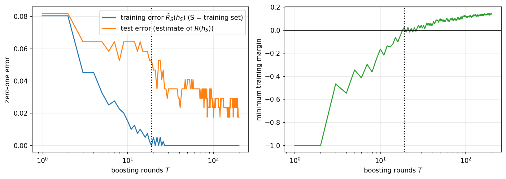
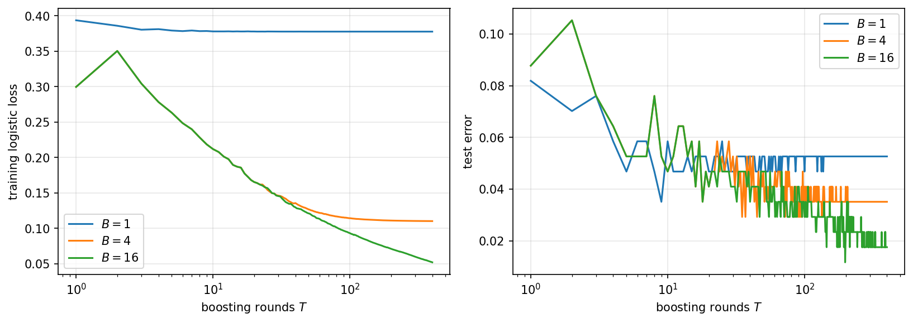

An **ensemble** aggregates the predictions of several hypotheses $h_1,\ldots,h_T$ into a single predictor. The constructions in this chapter differ in *how* the members are produced and in *which* term of the excess-risk decomposition of Chapter 6 they attack:

| | members produced | aggregation | attacks |
|---|---|---|---|
| **Bagging** | in parallel, on resampled data | unweighted average | the **variance** term |
| **Boosting** | in sequence, on reweighted data | weighted vote $\sum_t w_t h_t$ | the **approximation error** $\epsilon_{app}$ |
| **Gradient boosting** | in sequence, fit to pseudo-residuals | convex combination of the $h_t$ | the **approximation error** $\epsilon_{app}$, for any smooth convex loss |

Bagging takes a low-bias, high-variance base learner and averages its fluctuations away. Boosting takes a high-bias, low-variance base learner — one barely better than a coin flip — and composes many of them into a predictor of much greater capacity; this is the more surprising of the two, and it is where the theory of this chapter is concentrated. Gradient boosting, introduced last, keeps boosting's stagewise structure but replaces the exponential-loss reweighting of AdaBoost by a functional gradient step, which makes the construction work for any smooth convex loss, regression included.

# Bootstrap Aggregation (Bagging)

**Bagging** [Breiman (1996)](https://doi.org/10.1007/BF00058655)<!-- cite: breiman1996bagging | article | author={Breiman, Leo}; title={Bagging Predictors}; journal={Machine Learning}; year={1996}; volume={24}; number={2}; pages={123--140} --> is the technique this section formalizes.

**Definition 12.1.1 (Bootstrap sample).** Given $S = \{(x_i,y_i)\}_{i=1}^m$, a **bootstrap sample** of $S$ is
$$S' := \{(x_{j_k}, y_{j_k}) : j_k \sim \mathcal{U}(\{1,\ldots,m\}),\ k = 1,\ldots,m\},$$
i.e. $m$ indices drawn uniformly **with replacement**, so an index may repeat.

**Definition 12.1.2 (Bagged predictor).** Let $S_1,\ldots,S_T$ be bootstrap samples of $S$ and $h_{S_t} \gets A(S_t)$. The **bagged predictor** is
$$h_{S_1,\ldots,S_T}(x) := \frac{1}{T}\sum_{t=1}^T h_{S_t}(x).$$

Two elementary facts explain the benefit of averaging, both stated for the idealized case of $T$ **independent** samples $S_1,\ldots,S_T \sim \mathcal{D}^m$; bootstrapping approximates this by reusing one $S$, at the cost of correlation between the members, which is why the gains below are real but attenuated in practice.

---

**Proposition 12.1.3 (Averaging preserves bias and divides variance).** Let $h_{S_1},\ldots,h_{S_T}$ be i.i.d. as functions of independent samples $S_1,\ldots,S_T\sim\mathcal{D}^m$. Then for every fixed $x$,
$$\begin{gathered}
\mathbb{E}\Big[\tfrac{1}{T}\textstyle\sum_t h_{S_t}(x)\Big] = \mathbb{E}_S[h_S(x)], \\
\mathrm{Var}\Big[\tfrac{1}{T}\textstyle\sum_t h_{S_t}(x)\Big] = \tfrac{1}{T}\,\mathrm{Var}_S[h_S(x)].
\end{gathered}$$

***Proof.*** The first claim is linearity of expectation. For the second, independence makes all cross-covariances vanish, so
$$\mathrm{Var}\Big[\tfrac1T\sum_t h_{S_t}(x)\Big] = \tfrac{1}{T^2}\sum_{t=1}^T \mathrm{Var}[h_{S_t}(x)] + \tfrac{1}{T^2}\sum_{t \neq t'} \underbrace{\mathrm{Cov}[h_{S_t}(x), h_{S_{t'}}(x)]}_{=\,0} = \tfrac{1}{T^2}\cdot T\,\mathrm{Var}_S[h_S(x)]. \qquad\square$$

In the vocabulary of Chapter 6's bias-variance decomposition: the $\text{Bias}^2$ term is untouched and the $\text{Variance}$ term is divided by $T$. Letting $T\to\infty$, the weak law of large numbers (Theorem 5.6.3) gives $h_{S_1,\ldots,S_T}(x) \to \bar h(x) := \mathbb{E}_S[h_S(x)]$, the **average predictor** of Chapter 6.

---

**Proposition 12.1.4 (Bagging never hurts, in expectation).** For the squared loss, $R(\bar h) \leq \mathbb{E}_S[R(h_S)]$, with equality iff $\mathrm{Var}_S[h_S(x)]=0$ for $\mathcal{D}$-almost every $x$.

***Proof.*** Chapter 6 established $\mathbb{E}_S[R(h_S)] - R^*_{\mathcal{D}} = \text{Bias}^2 + \text{Variance}$ and $R(\bar h) - R^*_{\mathcal{D}} = \text{Bias}^2 = \|\bar h - f^*\|^2$. Subtracting, $\mathbb{E}_S[R(h_S)] - R(\bar h) = \text{Variance} = \mathbb{E}_x[\mathrm{Var}_S[h_S(x)]] \geq 0$. Equality holds exactly when the integrand vanishes almost everywhere. (Equivalently: this is Jensen's inequality for the convex map $t \mapsto t^2$.) $\square$

---

Proposition 12.1.4 compares $\bar h$ only to the *average* member. It can do better. If $\mathcal{H}$ is **not convex**, then $\bar h \notin \mathcal{H}$ in general, and $\bar h$ may be strictly closer to $f^*$ than *every* $h \in \mathcal{H}$ — the caveat already flagged in Chapter 6. Decision trees (Chapter 9) are such a class: an average of trees is not a tree. Bagged trees, with an extra randomization over the features considered at each split, are **random forests**, and this non-convexity is exactly the source of their strength. Bagging a *convex* class such as linear predictors, by contrast, cannot beat its best member, since there $\bar h \in \mathcal{H}$ already.

# Boosting

Boosting starts from the opposite premise: the base class is deliberately **too weak** to fit the data, and the ensemble must manufacture capacity rather than stability. Throughout this section $\mathcal{Y} = \{-1,+1\}$, so that the sign of a real-valued score is a prediction and $y\,f(x) > 0$ means "correct".

## Weak Learnability

**Definition 12.2.1 ($\gamma$-weak learner).** Let $\gamma \in (0, 1/2)$ and let $\mathcal{H}_0 \subseteq \{-1,+1\}^{\mathcal{X}}$ be a **base class**. A **$\gamma$-weak learner** for $\mathcal{H}_0$ is a procedure $\mathrm{WL}$ that maps a sample $S$ and a probability vector $D \in \Delta_m := \{D \in \mathbb{R}^m_{\geq0} : \sum_i D_i = 1\}$ to some $h = \mathrm{WL}(S,D) \in \mathcal{H}_0$ whose **$D$-weighted empirical error** satisfies
$$\widehat{R}_{S,D}(h) := \sum_{i=1}^m D_i\, \mathds{1}\big(h(x_i) \neq y_i\big) \;\leq\; \tfrac12 - \gamma .$$

---

The demand is minimal: a coin flip achieves $1/2$ in expectation, so $\mathrm{WL}$ must merely beat guessing by a fixed margin $\gamma$ — but it must do so for **every** reweighting $D$ of the sample, including adversarial ones that concentrate on the points previous rounds got wrong. This uniformity over $D$ is the whole content of the assumption, and it is what boosting consumes.

Definition 12.2.1 is the *empirical* form of weak learnability, stated over reweightings of a fixed sample because that is exactly the interface AdaBoost calls. Its distributional counterpart replaces "$D$ on $[m]$" by "any distribution $\mathcal{D}$ over $\mathcal{X}\times\mathcal{Y}$ realizable by $\mathcal{H}_0$" and asks for $R(h) \leq \tfrac12-\gamma$ with high probability from finitely many samples. The two are linked by the Fundamental Theorem (Theorem 6.4.7): if $d_{VC}(\mathcal{H}_0) < \infty$ then ERM over $\mathcal{H}_0$ is a $\gamma$-weak learner in the distributional sense for every $\gamma < 1/2$, given enough samples — so weak learnability is not a weaker *combinatorial* condition than PAC learnability, only a weaker *accuracy* requirement. Corollary 12.2.4 below shows that even that weakening yields no benefit: the two are equivalent.

**Definition 12.2.2 (Class of $T$-term linear combinations).** For a base class $\mathcal{H}_0$,
$$L(\mathcal{H}_0, T) := \Big\{ x \mapsto \mathrm{sign}\Big(\sum_{t=1}^T w_t h_t(x)\Big) \;:\; w \in \mathbb{R}^T,\ h_1,\ldots,h_T \in \mathcal{H}_0 \Big\}.$$

$\mathcal{H}_0 \subseteq L(\mathcal{H}_0,1) \subseteq L(\mathcal{H}_0,2) \subseteq \cdots$, so the ensemble class is a **nested family** indexed by $T$ — precisely the setting of nonuniform learnability and SRM (Chapter 6), with the number of rounds $T$ playing the role that the leaf budget played for decision trees in Chapter 9.

**Example (decision stumps).** $\mathcal{H}_{\mathrm{stump}} := \{x \mapsto s\,\mathrm{sign}(x_j - \theta) : j \in [d],\ \theta \in \mathbb{R},\ s \in \{-1,+1\}\}$. On any $m$ points, a stump's labeling is determined by the feature $j$ ($d$ choices), the position of $\theta$ among the $m$ observed values of that feature ($m+1$ choices), and the polarity $s$ ($2$ choices), so
$$\tau_{\mathcal{H}_{\mathrm{stump}}}(m) \leq 2d(m+1).$$
Since $\tau(m) = 2^m$ is needed to shatter, $d_{VC}(\mathcal{H}_{\mathrm{stump}}) = O(\log d)$: a stump is a genuinely weak hypothesis, unable even to represent a two-feature XOR. Yet $L(\mathcal{H}_{\mathrm{stump}}, T)$ grows rich with $T$, which is what makes stumps the canonical base class for boosting.

## AdaBoost

**AdaBoost** [Freund and Schapire (1997)](https://doi.org/10.1006/jcss.1997.1504)<!-- cite: freund1997decisiontheoretic | article | author={Freund, Yoav and Schapire, Robert E.}; title={A Decision-Theoretic Generalization of On-Line Learning and an Application to Boosting}; journal={Journal of Computer and System Sciences}; year={1997}; volume={55}; number={1}; pages={119--139} --> is the algorithm below.

**Input:** $S = \{(x_i,y_i)\}_{i=1}^m$ with $y_i \in \{-1,+1\}$; a weak learner $\mathrm{WL}$; a number of rounds $T$.

1. $D^{(1)} := \big(\tfrac1m, \ldots, \tfrac1m\big)$.
2. For $t = 1,\ldots,T$:
    1. $h_t := \mathrm{WL}\big(S, D^{(t)}\big)$
    2. $\displaystyle \epsilon_t := \sum_{i=1}^m D_i^{(t)}\,\mathds{1}\big(h_t(x_i) \neq y_i\big)$
    3. $\displaystyle w_t := \tfrac{1}{2}\log\Big(\frac{1-\epsilon_t}{\epsilon_t}\Big)$
    4. $\displaystyle D_i^{(t+1)} := \frac{D_i^{(t)}\, e^{-w_t y_i h_t(x_i)}}{\sum_{j=1}^m D_j^{(t)}\, e^{-w_t y_j h_t(x_j)}}, \qquad i = 1,\ldots,m$
3. **Output** $h_S := \mathrm{sign}(f_T) \in L(\mathcal{H}_0,T)$, where $\displaystyle f_T(x) := \sum_{t=1}^T w_t\, h_t(x)$.

Step 2.4 is one line because $y_i h_t(x_i) = +1$ on correct points and $-1$ on incorrect ones: the update multiplies a correct point's weight by $e^{-w_t}$ and an incorrect point's by $e^{+w_t}$, then renormalizes. The choice of $w_t$ in step 2.3 is not a guess; it is a minimization, as the proof below shows in one line.

---

**Theorem 12.2.3 (AdaBoost drives the training error down exponentially).** If $\epsilon_t \leq \tfrac12 - \gamma$ at every round, then the output of AdaBoost satisfies
$$\widehat{R}_S(h_S) = \frac{1}{m}\sum_{i=1}^m \mathds{1}\big(h_S(x_i) \neq y_i\big) \;\leq\; e^{-2\gamma^2 T}.$$

***Proof.*** Write $f_t := \sum_{p \leq t} w_p h_p$, $f_0 := 0$, and define the **exponential loss**
$$Z_t := \frac{1}{m}\sum_{i=1}^m e^{-y_i f_t(x_i)}.$$

*Step 1: the exponential loss dominates the zero-one loss.* Since $\mathds{1}(u \leq 0) \leq e^{-u}$ for all $u \in \mathbb{R}$, and $h_S(x_i)\neq y_i$ exactly when $y_i f_T(x_i) \leq 0$,
$$\widehat{R}_S(h_S) \leq Z_T .$$

*Step 2: the weights are the normalized exponential losses.* We claim
$$D_i^{(t)} = e^{-y_i f_{t-1}(x_i)} / \sum_j e^{-y_j f_{t-1}(x_j)}.$$
For $t=1$ both sides are $1/m$ since $f_0 = 0$. Assuming it at $t$, step 2.4 gives
$$D_i^{(t+1)} \;\propto\; D_i^{(t)} e^{-w_t y_i h_t(x_i)} \;\propto\; e^{-y_i f_{t-1}(x_i)} e^{-w_t y_i h_t(x_i)} = e^{-y_i f_t(x_i)},$$
and normalizing proves the claim at $t+1$.

*Step 3: the per-round progress factor.* Using Step 2, and splitting the sum according to whether $h_t$ is correct,
$$
\begin{aligned}
\frac{Z_t}{Z_{t-1}} = \frac{\sum_i e^{-y_i f_{t-1}(x_i)}\,e^{-w_t y_i h_t(x_i)}}{\sum_i e^{-y_i f_{t-1}(x_i)}} = \sum_{i=1}^m D_i^{(t)} e^{-w_t y_i h_t(x_i)} = \underbrace{(1-\epsilon_t)\,e^{-w_t} + \epsilon_t\, e^{w_t}}_{=:\ \psi(w_t)} .
\end{aligned}
$$
Now $\psi'(w) = -(1-\epsilon_t)e^{-w} + \epsilon_t e^{w} = 0$ gives $e^{2w} = (1-\epsilon_t)/\epsilon_t$, i.e. **exactly the $w_t$ of step 2.3** — this is where that formula comes from, and $\psi$ is convex, so it is a minimum. Substituting $e^{w_t} = \sqrt{(1-\epsilon_t)/\epsilon_t}$,
$$\frac{Z_t}{Z_{t-1}} = (1-\epsilon_t)\sqrt{\tfrac{\epsilon_t}{1-\epsilon_t}} + \epsilon_t\sqrt{\tfrac{1-\epsilon_t}{\epsilon_t}} = 2\sqrt{\epsilon_t(1-\epsilon_t)}.$$

*Step 4: telescoping.* Writing $\epsilon_t = \tfrac12 - \gamma_t$ with $\gamma_t \geq \gamma$, we get $2\sqrt{\epsilon_t(1-\epsilon_t)} = \sqrt{1-4\gamma_t^2} \leq e^{-2\gamma_t^2} \leq e^{-2\gamma^2}$, using $1-u \leq e^{-u}$ with $u = 4\gamma_t^2$ under the square root. Since $Z_0 = 1$,
$$\widehat{R}_S(h_S) \leq Z_T = \prod_{t=1}^T \frac{Z_t}{Z_{t-1}} \leq e^{-2\gamma^2 T}. \qquad\square$$

Two readings of the proof are worth keeping. First, AdaBoost is **coordinate-wise greedy minimization of the exponential loss** $Z_t$: step 2.1 picks the direction $h_t$ and step 2.3 picks the optimal step size $w_t$ along it. Second, the weighting scheme is not an extra heuristic layered on top — Step 2 shows $D^{(t)}$ *is* the exponential loss, normalized, so up-weighting the currently misclassified points is exactly what greedy minimization of $Z_t$ prescribes.

---

**Corollary 12.2.4 (Weak learnability implies strong learnability).** Let $\mathcal{H}_0$ admit a $\gamma$-weak learner and run AdaBoost for $T \geq \frac{\log m}{2\gamma^2}$ rounds. Then $\widehat{R}_S(h_S) = 0$.

***Proof.*** By Theorem 12.2.3, $\widehat{R}_S(h_S) \leq e^{-2\gamma^2 T} \leq e^{-\log m} = 1/m$. But $\widehat{R}_S(h_S)$ is a multiple of $1/m$, and the only such value strictly below $1/m$ is $0$. $\square$

This is the theorem that made boosting famous: a learner that can only beat a coin flip by $\gamma$, on every reweighting of the sample, can be compiled into one that fits the sample perfectly, in $O(\gamma^{-2}\log m)$ rounds. **Weak** and **strong** learnability are the same notion, up to computation. What remains is to price the generalization of the resulting predictor — and this is where two different complexity measures give two genuinely different answers.

## What Linear Combinations Cost: Three Accounts

### Account 1: the VC dimension of $L(\mathcal{H}_0,T)$ grows with $T$

**Lemma 12.2.5.** Let $d_0 := d_{VC}(\mathcal{H}_0) < \infty$ (not to be confused with the feature dimension $d$). Then
$$
\begin{aligned}
\tau_{L(\mathcal{H}_0,T)}(m) &\;\leq\; \tau_{\mathcal{H}_0}(m)^T \cdot \Big(\frac{em}{T}\Big)^{T} \;\leq\; \Big(\frac{em}{d_0}\Big)^{d_0T}\Big(\frac{em}{T}\Big)^{T}, \\
&\qquad\text{hence}\qquad d_{VC}\big(L(\mathcal{H}_0,T)\big) = O\big(d_0T\log(d_0T)\big).
\end{aligned}
$$

***Proof.*** Fix $S = \{x_1,\ldots,x_m\}$. A hypothesis of $L(\mathcal{H}_0,T)$ is specified by base hypotheses $h_1,\ldots,h_T$ and weights $w$. Its restriction to $S$ depends on the $h_t$ only through their own restrictions to $S$, and there are at most $\tau_{\mathcal{H}_0}(m)$ of those per slot, hence at most $\tau_{\mathcal{H}_0}(m)^T$ jointly. Having fixed them, map each point to $v_i := (h_1(x_i),\ldots,h_T(x_i)) \in \{-1,+1\}^T$; the remaining freedom is the labeling $\mathrm{sign}(w^\top v_i)$, i.e. a homogeneous halfspace in $\mathbb{R}^T$ applied to $m$ fixed points. The class of homogeneous halfspaces in $\mathbb{R}^T$ has VC dimension $T$, so by Sauer-Shelah-Perles (Lemma 6.4.8) it realizes at most $(em/T)^T$ labelings. Multiplying the two counts gives the first claim, and the second follows from Lemma 6.4.8 applied to $\mathcal{H}_0$. For the VC bound, shattering $m$ points requires $2^m \leq \tau_{L(\mathcal{H}_0,T)}(m)$, i.e. $m\log 2 \leq (d_0T+T)\log(em)$, which forces $m = O(d_0T\log(d_0T))$. $\square$

Feeding $d_{VC}(L(\mathcal{H}_0,T)) = O(d_0T\log(d_0T))$ into the Fundamental Theorem (Theorem 6.4.7) gives, with probability at least $1-\delta$, for every $h \in L(\mathcal{H}_0,T)$,

$$R(h) \;\leq\; \widehat{R}_S(h) + O\left(\sqrt{\frac{d_0T\log(d_0T) + \log(1/\delta)}{m}}\right). \tag{12.1}$$

Combined with Corollary 12.2.4 this already proves boosting works: choose $T \asymp \gamma^{-2}\log m$, get $\widehat{R}_S = 0$, and read off a nonvacuous bound as soon as $m \gtrsim d_0\gamma^{-2}\log^2 m$. It also makes a **prediction**: the bound degrades as $\sqrt{T}$, so running AdaBoost past the point where it fits the sample should start to overfit. Empirically, this prediction fails — AdaBoost's test error typically keeps *improving* for hundreds of rounds after the training error hits zero. The bound is not wrong; it is measuring the wrong quantity.

### Account 2: the Rademacher complexity of the convex hull does not grow at all

Assume $\mathcal{H}_0$ is **symmetric** ($h \in \mathcal{H}_0 \Rightarrow -h \in \mathcal{H}_0$; true for stumps, by flipping $s$). Then we may take every $w_t \geq 0$ without loss of generality, and the **normalized ensemble**
$$\begin{gathered}
\bar f_T(x) := \frac{f_T(x)}{\sum_{t=1}^T w_t} = \sum_{t=1}^T \lambda_t h_t(x), \\
\lambda_t := \frac{w_t}{\sum_p w_p} \geq 0,\ \ \sum_t \lambda_t = 1,
\end{gathered}$$
is a **convex combination** of members of $\mathcal{H}_0$, i.e. $\bar f_T \in \mathrm{conv}(\mathcal{H}_0)$, with $\bar f_T(x) \in [-1,1]$. Note $\mathrm{sign}(\bar f_T) = \mathrm{sign}(f_T) = h_S$: normalizing changes no prediction, only the scale on which we may measure *how confidently* each prediction was made.

---

**Theorem 12.2.6 (Convexification is free).** For any $A \subset \mathbb{R}^m$, $\widehat{\mathfrak{R}}(\mathrm{conv}(A)) = \widehat{\mathfrak{R}}(A)$. In particular $\widehat{\mathfrak{R}}_S(\mathrm{conv}(\mathcal{H}_0)) = \widehat{\mathfrak{R}}_S(\mathcal{H}_0)$ for every $S$, **independently of $T$**.

***Proof.*** $A \subseteq \mathrm{conv}(A)$ gives "$\geq$". For "$\leq$", fix the signs $\sigma \in \{-1,+1\}^m$ and let $a = \sum_j \lambda_j a^{(j)} \in \mathrm{conv}(A)$ with $\lambda_j \geq 0$, $\sum_j \lambda_j = 1$. By linearity of the inner product,
$$\langle \sigma, a\rangle = \sum_j \lambda_j \langle \sigma, a^{(j)}\rangle \leq \Big(\sum_j \lambda_j\Big) \max_j \langle \sigma, a^{(j)}\rangle \leq \sup_{a' \in A} \langle \sigma, a'\rangle .$$
Taking the supremum over $a \in \mathrm{conv}(A)$ and then $\mathbb{E}_\sigma$ of both sides gives the claim. $\square$

---

**Theorem 12.2.7 (Margin bound for boosting).** Let $\mathcal{H}_0$ be symmetric with values in $\{-1,+1\}$, fix a **margin threshold** $\nu \in (0,1]$ — a free parameter of the bound, unrelated to the weak-learning parameter $\gamma$ of Definition 12.2.1 — and let $\bar f \in \mathrm{conv}(\mathcal{H}_0)$ be arbitrary. Then with probability at least $1-\delta$ over $S \sim \mathcal{D}^m$, simultaneously for every such $\bar f$,
$$
\begin{aligned}
R\big(\mathrm{sign}(\bar f)\big) &\;=\; P_{(x,y)\sim\mathcal{D}}\big(y\,\bar f(x) \leq 0\big) \;\leq\; \underbrace{\frac{1}{m}\sum_{i=1}^m \mathds{1}\big(y_i \bar f(x_i) \leq \nu\big)}_{\text{fraction of training margins} \,\leq\, \nu} \\
&\;+\; \frac{2}{\nu}\,\widehat{\mathfrak{R}}_S(\mathcal{H}_0) \;+\; 3\sqrt{\frac{\log(2/\delta)}{2m}} .
\end{aligned}
$$

***Proof.*** Call $y\bar f(x) \in [-1,1]$ the **margin** of the prediction — positive exactly when the weighted vote is correct, and large when it is correct by a wide majority. Define the **$\nu$-margin loss**
$$\phi_\nu(u) := \min\big(1, \max(0, 1 - u/\nu)\big),$$
which is $\tfrac{1}{\nu}$-Lipschitz, takes values in $[0,1]$, and satisfies the sandwich $\mathds{1}(u \leq 0) \leq \phi_\nu(u) \leq \mathds{1}(u \leq \nu)$.

Apply the Rademacher generalization bound (Theorem 7.3.2) to the loss class $\big\{(x,y)\mapsto \phi_\nu\big(y\bar f(x)\big) : \bar f \in \mathrm{conv}(\mathcal{H}_0)\big\}$, whose values lie in $[0,1]$: with probability $\geq 1-\delta$, for all $\bar f$,
$$\mathbb{E}_{\mathcal{D}}\big[\phi_\nu(y\bar f(x))\big] \leq \frac1m\sum_i \phi_\nu\big(y_i \bar f(x_i)\big) + 2\,\widehat{\mathfrak{R}}_S\big(\phi_\nu \circ \mathrm{conv}(\mathcal{H}_0)\big) + 3\sqrt{\tfrac{\log(2/\delta)}{2m}} .$$
The left side is $\geq P_{\mathcal{D}}\big(y\bar f(x)\leq 0\big)$ and the empirical average is $\leq \frac1m\sum_i \mathds{1}(y_i\bar f(x_i)\leq\nu)$, both by the sandwich. For the middle term, note that the contraction lemma (Lemma 7.3.4) permits a *different* function in each coordinate: take $\phi_i(u) := \phi_\nu(y_i u)$, which is $\tfrac1\nu$-Lipschitz for either sign of $y_i$, so contracting with these removes both the label multiplication and the margin loss in one step. Theorem 12.2.6 then removes the convex hull:
$$\widehat{\mathfrak{R}}_S\big(\phi_\nu \circ \mathrm{conv}(\mathcal{H}_0)\big) \;\leq\; \tfrac1\nu\,\widehat{\mathfrak{R}}_S\big(\mathrm{conv}(\mathcal{H}_0)\big) \;=\; \tfrac1\nu\,\widehat{\mathfrak{R}}_S(\mathcal{H}_0). \qquad\square$$

---

**The resolution.** Compare (12.1) with Theorem 12.2.7, term by term:

| | Account 1 (VC of $L(\mathcal{H}_0,T)$) | Account 2 (Rademacher of $\mathrm{conv}(\mathcal{H}_0)$) |
|---|---|---|
| fit term | $\widehat{R}_S(h_S)$, hits $0$ and then stops moving | $\frac1m\sum_i\mathds{1}(y_i\bar f_T(x_i)\leq\nu)$, **keeps shrinking** |
| complexity term | $O(\sqrt{d_0T\log(d_0T)/m})$, **grows with $T$** | $\frac{2}{\nu}\widehat{\mathfrak{R}}_S(\mathcal{H}_0)$, **independent of $T$** |

Account 2 says that additional boosting rounds incur no additional complexity — a convex combination of $T$ members is no richer, in the Rademacher sense, than a single member — while they continue to improve a quantity that the zero-one training error is too coarse to reveal: Theorem 12.2.3's proof shows AdaBoost keeps driving the exponential loss $Z_t$ down after $\widehat{R}_S = 0$, and $Z_t$ is small only when the margins $y_i f_t(x_i)$ are *large*, not merely positive. Boosting past zero training error is therefore not idle: it is converting correct-but-marginal predictions into correct-and-confident ones, which is precisely what the first term of Theorem 12.2.7 rewards. This is the same lesson as Chapter 10's: the complexity measure that grows with the number of parameters is the wrong choice, and a scale-sensitive measure — margins here, weight norms there — is the right one.

The trade-off has not disappeared, it has moved into $\nu$: a larger $\nu$ shrinks the complexity term but makes the margin-violation term larger. The bound holds for all $\nu$ simultaneously (up to a union bound over a grid of $\nu$'s), so one may read it at whichever $\nu$ is most favorable for the ensemble actually obtained.

### Account 3: the price of an ensemble is its total weight

Account 2 normalized the ensemble to the convex combination $\bar f_T = f_T/\sum_t w_t$. The third account prices the *unnormalized* scale. For a symmetric $\mathcal{H}_0$ and $f = \sum_{t=1}^T w_t h_t$, the **total weight** is $\|w\|_1 := \sum_t |w_t|$, and the ensembles of total weight at most $A$ form the class $\mathcal{F}_{A,L_1}(\mathcal{H}_0)$ of Theorem 7.7.2 (Chapter 7), whose empirical Rademacher complexity is exactly
$$\widehat{\mathfrak{R}}_S\big(\mathcal{F}_{A,L_1}(\mathcal{H}_0)\big) = A\cdot\widehat{\mathfrak{R}}_S(\mathcal{H}_0),$$
**independently of the number of rounds $T$**. Account 2's "convexification is free" is the case $A = 1$.

* The price of an ensemble is its total weight $A$, not its member count $T$ — the same accounting as Chapter 10's width-independent Theorem 10.5.2 for $L_1$-constrained output layers, and the reason an $L_1$ penalty such as the Lasso of Chapter 3 controls capacity through a norm rather than through the number of parameters.
* For AdaBoost the total weight $\sum_t w_t$ grows with $T$. Theorem 12.2.7 absorbs this growth by normalizing and measuring margins on the normalized scale; Account 3 says equivalently that the unnormalized $f_T$ belongs to a class whose complexity grows linearly in $\sum_t w_t$.
* Combined with Maurey's lemma (Theorem 7.7.1, Chapter 7), the account explains why stagewise greedy search is reasonable: every point of $\mathcal{F}_{A,L_1}(\mathcal{H}_0)$ is, on the sample, within $AB/\sqrt N$ of an $N$-term average of members of $\mathcal{H}_0$, so a procedure that adds one member per round searches a set that already contains good sparse approximants of every point of the full class. Theorem 12.3.1 below is the algorithmic counterpart of this approximation fact.

## Implementation: AdaBoost with Decision Stumps

We implement Definition 12.2.1 and the AdaBoost pseudocode literally: the weak learner is an exhaustive search over $\mathcal{H}_{\mathrm{stump}}$ for the stump of least $D$-weighted error, and the boosting loop is the four numbered steps. The data set is the **Wisconsin Breast Cancer** set of Chapters 8 and 9 ($569$ samples, $d=30$ features), with labels recoded to $\{-1,+1\}$. Alongside the two error curves we track $\min_i y_i \bar f_T(x_i)$, the smallest training margin — the quantity Theorem 12.2.7 says should keep improving after the training error stops.

```python
# AdaBoost implemented from scratch: the base class is decision stumps, the
# weak learner is an exhaustive weighted-error search over them, and the
# boosting loop is line-for-line the pseudocode above.

import torch as th
import matplotlib.pyplot as plt
from sklearn.datasets import load_breast_cancer

th.manual_seed(0)

data = load_breast_cancer()
X_all = th.tensor(data.data, dtype=th.float64)
y_all = 2 * th.tensor(data.target, dtype=th.float64) - 1   # labels in {-1,+1}
idx = th.randperm(y_all.numel())
n_tr = int(0.7 * y_all.numel())
tr, te = idx[:n_tr], idx[n_tr:]
X, y = X_all[tr], y_all[tr]
X_te, y_te = X_all[te], y_all[te]
m, d = X.shape
order = th.argsort(X, dim=0)                           # sort once, reuse

# --- The base class: decision stumps  h(x) = s * sign(x_j - theta) ----------

def weak_learner(D):
    """Return the stump of least D-weighted empirical error, by exhaustive
    search over all d features and all m+1 distinct thresholds of each."""
    best = (float('inf'), 0, -float('inf'), 1)         # (err, j, theta, s)
    for j in range(d):
        o = order[:, j]
        xs, ys, Ds = X[o, j], y[o], D[o]
        # Sweep theta from left to right. At theta = -inf the stump predicts
        # +1 everywhere, so its error is the weight of the negative points;
        # each time theta passes a point, that point's prediction flips,
        # changing the error by +D_i if y_i = +1 and by -D_i if y_i = -1.
        errs = Ds[ys == -1].sum() + th.cat([th.zeros(1, dtype=D.dtype),
                                            th.cumsum(Ds * ys, dim=0)])
        thetas = th.cat([th.tensor([-float('inf')], dtype=xs.dtype), xs])
        # A threshold can only fall between two *distinct* values: with ties,
        # x > theta sends all copies of a value to the same side.
        valid = th.ones(m + 1, dtype=th.bool)
        valid[1:m] = xs[:-1] < xs[1:]
        for s in (1, -1):                              # both leaf polarities
            e = errs if s == 1 else 1.0 - errs
            e = th.where(valid, e, th.tensor(float('inf'), dtype=e.dtype))
            k = int(e.argmin())
            if e[k] < best[0]:
                best = (e[k].item(), j, thetas[k].item(), s)
    return best[1:]                                    # (j, theta, s)

def stump_predict(Xq, stump):
    j, theta, s = stump
    return s * th.where(Xq[:, j] > theta, 1.0, -1.0).double()

# --- AdaBoost ---------------------------------------------------------------

T = 200
D = th.full((m,), 1.0 / m, dtype=th.float64)           # step 1: D^(1)
w_sum = 0.0
F, F_te = th.zeros(m, dtype=th.float64), th.zeros(y_te.numel(), dtype=th.float64)
err_tr, err_te, min_margin = [], [], []

for t in range(T):
    stump = weak_learner(D)                            # 2.1  h_t = WL(S,D^(t))
    pred = stump_predict(X, stump)
    eps = D[pred != y].sum()                           # 2.2  epsilon_t
    eps = eps.clamp(1e-10, 1 - 1e-10)                  #      guard log(0)
    w_t = 0.5 * th.log(1.0 / eps - 1.0)                # 2.3  w_t
    D = D * th.exp(-w_t * y * pred)                    # 2.4  reweight ...
    D = D / D.sum()                                    #      ... and normalise

    w_sum += w_t.item()                                # bookkeeping only:
    F += w_t * pred                                    #   f_t on the train set
    F_te += w_t * stump_predict(X_te, stump)           #   f_t on the test set
    err_tr.append((th.sign(F) != y).double().mean().item())
    err_te.append((th.sign(F_te) != y_te).double().mean().item())
    min_margin.append((y * F / w_sum).min().item())    # min_i y_i bar-f_t(x_i)

t0 = next(t for t, e in enumerate(err_tr) if e == 0.0)
print("       T   train err   test err   min margin")
for t in [0, 4, 9, t0, 49, 99, T - 1]:
    print(f"{t+1:8d}    {err_tr[t]:.4f}     {err_te[t]:.4f}     {min_margin[t]:+.4f}")
print(f"\ntraining error first reaches 0 at T = {t0+1}")

rounds = th.arange(1, T + 1)
fig, ax = plt.subplots(1, 2, figsize=(11, 4))
ax[0].plot(rounds, err_tr, label=r"training error $\widehat{R}_S(h_S)$ (S = training set)")
ax[0].plot(rounds, err_te, label=r"test error (estimate of $R(h_S)$)")
ax[0].axvline(t0 + 1, ls=":", c="k")
ax[0].set_xscale("log"); ax[0].set_xlabel("boosting rounds $T$")
ax[0].set_ylabel("zero-one error"); ax[0].legend(); ax[0].grid(alpha=.3)
ax[1].plot(rounds, min_margin, c="C2")
ax[1].axvline(t0 + 1, ls=":", c="k"); ax[1].axhline(0, lw=.5, c="k")
ax[1].set_xscale("log"); ax[1].set_xlabel("boosting rounds $T$")
ax[1].set_ylabel(r"minimum training margin")
ax[1].grid(alpha=.3)
plt.tight_layout(); plt.show()
```

           T   train err   test err   min margin
           1    0.0804     0.0819     -1.0000
           5    0.0327     0.0643     -0.3449
          10    0.0151     0.0643     -0.1646
          19    0.0000     0.0526     +0.0225
          50    0.0000     0.0409     +0.0990
         100    0.0000     0.0234     +0.1198
         200    0.0000     0.0175     +0.1441

    training error first reaches 0 at T = 19



The numbers track the theory. Across the $200$ rounds the worst weighted error the stump search ever returns is $\epsilon_t = 0.376$, so the weak-learning parameter realized on this data set is $\gamma = 0.124$. Theorem 12.2.3 then guarantees only $\widehat{R}_S \leq e^{-2(0.124)^2\cdot 19} \approx 0.56$ after $19$ rounds, and Corollary 12.2.4's sufficient budget is $\log(398)/(2\cdot0.124^2) \approx 193$ rounds — both valid but, as worst-case bounds usually are, far more conservative than what actually happens: the training error is already exactly $0$ at $T = 19$. From $T=19$ onward, the first term of Account 1 is frozen at $0$ and its complexity term keeps growing, so (12.1) predicts deterioration; instead the test error *falls further*, from $5.3\%$ to $1.8\%$. Account 2 explains why: over the same rounds the smallest training margin climbs from $+0.023$ to $+0.144$, so the margin-violation term of Theorem 12.2.7 keeps shrinking at any fixed threshold $\nu \lesssim 0.14$, while its complexity term $\frac2\nu \widehat{\mathfrak{R}}_S(\mathcal{H}_{\mathrm{stump}})$ never moves.

# Gradient Boosting

AdaBoost minimizes the exponential loss by greedy coordinate descent (the first reading of Theorem 12.2.3's proof). **Gradient boosting** — [Friedman (2001)](https://doi.org/10.1214/aos/1013203451)<!-- cite: friedman2001greedy | article | author={Friedman, Jerome H.}; title={Greedy Function Approximation: A Gradient Boosting Machine}; journal={Annals of Statistics}; year={2001}; volume={29}; number={5}; pages={1189--1232} -->, [Mason et al. (1999)](https://papers.nips.cc/paper/1766-boosting-algorithms-as-gradient-descent)<!-- cite: mason1999boosting | inproceedings | author={Mason, Llew and Baxter, Jonathan and Bartlett, Peter L. and Frean, Marcus}; title={Boosting Algorithms as Gradient Descent}; booktitle={Advances in Neural Information Processing Systems 12}; year={1999}; pages={512--518} --> — runs the same greedy scheme on any differentiable loss $L(f,y)$.

Throughout this section $\langle a,b\rangle_S := \frac1m\sum_{i=1}^m a_ib_i$ and $\|a\|_S := \langle a,a\rangle_S^{1/2}$ for functions or vectors evaluated on the sample, as in Chapter 7, and
$$\widehat{L}(f) := \frac1m\sum_{i=1}^m L\big(f(x_i),y_i\big)$$
is the empirical loss. $\widehat{L}$ depends on $f$ only through the prediction vector $(f(x_1),\ldots,f(x_m))$, and its gradient with respect to that vector is $-\frac1m r$, where
$$r_i := -\frac{\partial L(a,y_i)}{\partial a}\Big|_{a=f(x_i)}, \qquad i = 1,\ldots,m,$$
are the **pseudo-residuals**. A gradient step on the prediction vector would produce a vector, not a function; boosting replaces it by a step towards the base hypothesis best aligned with $r$.

**AdaBoost as a special case.** For the exponential loss $L(f,y) = e^{-yf}$ the pseudo-residuals are $r_i = y_ie^{-y_if(x_i)}$, which by Step 2 of the proof of Theorem 12.2.3 are proportional to $y_iD_i^{(t)}$ at $f = f_{t-1}$. For $h$ with values in $\{-1,+1\}$, $y_ih(x_i) = 1 - 2\,\mathds{1}(h(x_i) \neq y_i)$, so
$$\sum_i r_ih(x_i) \;\propto\; \sum_i D_i^{(t)}y_ih(x_i) = 1 - 2\epsilon_t(h):$$
the base hypothesis best aligned with the pseudo-residuals is the one of least weighted error, AdaBoost's step 2.1, and Step 3 of the proof showed that $w_t$ is the exact minimizer of the loss along it. For the squared loss $L(f,y) = \tfrac12(f-y)^2$, the pseudo-residuals $r_i = y_i - f(x_i)$ are the ordinary residuals, and boosting fits each new member to what the current ensemble still gets wrong.

**The construction.** The version we analyze is the conditional-gradient method of [Frank & Wolfe (1956)](https://doi.org/10.1002/nav.3800030109)<!-- cite: frank1956algorithm | article | author={Frank, Marguerite and Wolfe, Philip}; title={An Algorithm for Quadratic Programming}; journal={Naval Research Logistics Quarterly}; year={1956}; volume={3}; number={1--2}; pages={95--110} --> run over the convex hull of the base class, in the greedy-approximation form of [Jones (1992)](https://doi.org/10.1214/aos/1176348546)<!-- cite: jones1992simple | article | author={Jones, Lee K.}; title={A Simple Lemma on Greedy Approximation in Hilbert Space and Convergence Rates for Projection Pursuit Regression and Neural Network Training}; journal={Annals of Statistics}; year={1992}; volume={20}; number={1}; pages={608--613} --> and [Zhang (2003)](https://doi.org/10.1109/TIT.2002.808136)<!-- cite: zhang2003sequential | article | author={Zhang, Tong}; title={Sequential Greedy Approximation for Certain Convex Optimization Problems}; journal={IEEE Transactions on Information Theory}; year={2003}; volume={49}; number={3}; pages={682--691} -->. It assumes $L$ convex and **$\beta$-smooth** in its first argument: $a \mapsto \partial L(a,y)/\partial a$ is $\beta$-Lipschitz for every $y$. The logistic loss $\log(1+e^{-yf})$ of Chapter 4 has second derivative $\sigma(yf)\sigma(-yf) \leq \tfrac14$, so $\beta = \tfrac14$; the squared loss has $\beta = 1$; the exponential loss is smooth only on bounded predictions. The base class $\mathcal{H}_0$ consists of real-valued functions with
$$B^2 := \sup_{h\in\mathcal{H}_0}\|h\|_S^2 < \infty.$$
Start from $f^{(0)} := 0$ and, for $t = 1,\ldots,T$, with $\eta_t := \frac{2}{t+1}$:

1. Compute the pseudo-residuals $r^{(t)}$ at $f^{(t-1)}$.
2. Fit the base learner by least squares, $\displaystyle h_t \in \arg\min_{h\in\mathcal{H}_0}\ \big\|\beta\eta_t\,h - r^{(t)}\big\|_S^2$.
3. Average, $f^{(t)} := (1-\eta_t)f^{(t-1)} + \eta_t h_t$.

Since $\eta_1 = 1$, $f^{(1)} = h_1$, and every $f^{(t)}$ is a convex combination of $h_1,\ldots,h_t$: the iterates stay in $\mathrm{conv}(\mathcal{H}_0)$, and the algorithm is a conditional-gradient (Frank-Wolfe) method on the hull. Expanding the square in step 2 and dropping the term $\|r^{(t)}\|_S^2$, which does not depend on $h$, step 2 minimizes
$$-2\eta_t\langle r^{(t)},h\rangle_S + \beta\eta_t^2\|h\|_S^2,$$
a trade-off between alignment with the pseudo-residuals and the curvature penalty that smoothness charges for a step of length $\eta_t$ towards $h$. The target $r^{(t)}/(\beta\eta_t)$ grows as $\eta_t$ shrinks, but the fit is confined to $\mathcal{H}_0$, so the actual step $\eta_t(h_t - f^{(t-1)})$ shrinks.

---

**Theorem 12.3.1 (Gradient boosting converges on the convex hull).** Let $L$ be convex and $\beta$-smooth in its first argument, let $B^2 := \sup_{h\in\mathcal{H}_0}\|h\|_S^2$, and let each round compute an exact minimizer in step 2. Then for every $T \geq 1$,
$$\widehat{L}\big(f^{(T)}\big) \;\leq\; \inf_{f \in \mathrm{conv}(\mathcal{H}_0)}\widehat{L}(f) \;+\; \frac{8\beta B^2}{T+1}.$$

**Proof.** Fix a competitor $f = \sum_j u_j\psi_j \in \mathrm{conv}(\mathcal{H}_0)$ with $u_j \geq 0$, $\sum_j u_j = 1$, $\psi_j \in \mathcal{H}_0$, and let $\Delta_t := \widehat{L}(f^{(t)}) - \widehat{L}(f)$. Fix a round $t$ and abbreviate $\eta := \eta_t$, $r := r^{(t)}$, $h := h_t$, $f_- := f^{(t-1)}$. The norm $\|\cdot\|_S$ is convex, so $\|f_-\|_S \leq B$ ($f_-$ is $0$ or a convex combination of members of $\mathcal{H}_0$), and likewise $\|f\|_S \leq B$.

*Step 1: smoothness.* Lemma 10.5.3(i) of Chapter 10, in dimension one, applied to $a \mapsto L(a,y_i)$ between $f_-(x_i)$ and $f^{(t)}(x_i) = f_-(x_i) + \eta\,(h - f_-)(x_i)$ and averaged over $i$, gives
$$\widehat{L}(f^{(t)}) \;\leq\; \widehat{L}(f_-) - \eta\langle r, h - f_-\rangle_S + \frac{\beta\eta^2}{2}\|h - f_-\|_S^2 \;\leq\; \widehat{L}(f_-) - \eta\langle r, h - f_-\rangle_S + \beta\eta^2\big(\|h\|_S^2 + B^2\big),$$
using $\|a - b\|_S^2 \leq 2\|a\|_S^2 + 2\|b\|_S^2$.

*Step 2: least-squares optimality.* Comparing $h$ with each $\psi_j$ in step 2 and averaging with the weights $u_j$,
$$-2\eta\langle r,h\rangle_S + \beta\eta^2\|h\|_S^2 \;\leq\; \sum_j u_j\Big(-2\eta\langle r,\psi_j\rangle_S + \beta\eta^2\|\psi_j\|_S^2\Big) \;\leq\; -2\eta\langle r,f\rangle_S + \beta\eta^2B^2.$$
Hence, using also $\|h\|_S \leq B$,
$$-\eta\langle r,h\rangle_S + \beta\eta^2\|h\|_S^2 = \tfrac12\Big(-2\eta\langle r,h\rangle_S + \beta\eta^2\|h\|_S^2\Big) + \tfrac{\beta\eta^2}{2}\|h\|_S^2 \;\leq\; -\eta\langle r,f\rangle_S + \beta\eta^2B^2,$$
and Step 1 becomes
$$\widehat{L}(f^{(t)}) \;\leq\; \widehat{L}(f_-) + \eta\langle r, f_- - f\rangle_S + 2\beta\eta^2B^2.$$
*Step 3: convexity.* The first-order condition for the convex $\widehat{L}$, whose gradient is $-\frac1m r$, reads $\widehat{L}(f) \geq \widehat{L}(f_-) - \langle r, f - f_-\rangle_S$, i.e. $\langle r, f_- - f\rangle_S \leq -\Delta_{t-1}$. Therefore
$$\Delta_t \;\leq\; (1-\eta_t)\,\Delta_{t-1} + 2\beta\eta_t^2B^2 = \frac{t-1}{t+1}\,\Delta_{t-1} + \frac{8\beta B^2}{(t+1)^2}.$$
*Step 4: the recursion.* Multiplying by $t(t+1)$,
$$t(t+1)\,\Delta_t \;\leq\; (t-1)t\,\Delta_{t-1} + 8\beta B^2\,\frac{t}{t+1} \;\leq\; (t-1)t\,\Delta_{t-1} + 8\beta B^2.$$
Summing over $t = 1,\ldots,T$, the left-hand terms telescope and the first one vanishes (its coefficient is $0\cdot1$), so $T(T+1)\Delta_T \leq 8\beta B^2T$. Since $f \in \mathrm{conv}(\mathcal{H}_0)$ was arbitrary, the claim follows $\square$

Bounds of this type go back to the greedy-approximation analyses of Jones (1992) and Zhang (2003); [Jaggi (2013)](https://proceedings.mlr.press/v28/jaggi13.html)<!-- cite: jaggi2013revisiting | inproceedings | author={Jaggi, Martin}; title={Revisiting {Frank-Wolfe}: Projection-Free Sparse Convex Optimization}; booktitle={Proceedings of the 30th International Conference on Machine Learning}; series={PMLR}; volume={28}; number={1}; year={2013}; pages={427--435} --> gives the corresponding analysis of the Frank-Wolfe method. The theorem is the algorithmic counterpart of Maurey's lemma (Theorem 7.7.1): the infimum over the *convex hull* is approached, at rate $O(1/T)$, by a $T$-term combination, found greedily without ever solving an optimization problem over $\mathrm{conv}(\mathcal{H}_0)$.

**What the scale $B$ controls.** Write $\mathcal{H}_0 = B\cdot\mathcal{H}_1$ for a fixed class $\mathcal{H}_1$ with $\sup_{h\in\mathcal{H}_1}\|h\|_S \leq 1$. Then $B$ enters the analysis three times:
* *approximation:* $\mathrm{conv}(B\mathcal{H}_1)$ grows with $B$, so $\inf_{f}\widehat{L}(f)$ decreases;
* *optimization:* the convergence term $8\beta B^2/(T+1)$ grows as $B^2$, so more rounds are needed;
* *complexity:* $\widehat{\mathfrak{R}}_S(\mathrm{conv}(B\mathcal{H}_1)) = B\,\widehat{\mathfrak{R}}_S(\mathcal{H}_1)$ by Theorem 12.2.6, so, through the contraction lemma and Theorem 7.3.2 for a Lipschitz loss such as the logistic one, the generalization gap grows linearly in $B$ — Account 3, with $A = B$.

$B$ is therefore a regularization parameter of the same kind as the number of rounds $T$ in AdaBoost, trading the approximation error against the estimation error.

## Implementation: Gradient Boosting with Regression Stumps

We implement the construction on the same split of the Wisconsin Breast Cancer data as the AdaBoost experiment, with the logistic loss ($\beta = \tfrac14$). The base class consists of regression stumps $h(x) = s_L$ if $x_j \leq \theta$ and $h(x) = s_R$ otherwise, with leaf values $s_L, s_R \in [-B,B]$, so that $\sup_h\|h\|_S \leq B$ as Theorem 12.3.1 requires. Step 2 is solved exactly: for a fixed split the least-squares problem separates over the two leaves, and on each leaf the minimizer of $\sum_i (s - u_i)^2$ over $s \in [-B,B]$ is the leaf mean of the target clipped to $[-B,B]$. Every split is therefore scored in $O(1)$ from prefix sums over the sorted feature values, and the base learner is an exhaustive search over all $O(dm)$ splits. We run the algorithm for $B \in \{1, 4, 16\}$.

```python
# Gradient boosting from scratch, as in the pseudocode above: logistic loss,
# base class = regression stumps with leaf values in [-B, B], each round an
# exact least-squares fit of beta*eta_t*h to the pseudo-residuals, and the
# averaging update with eta_t = 2/(t+1) of Theorem 12.3.1.

import torch as th
import matplotlib.pyplot as plt
from sklearn.datasets import load_breast_cancer

th.manual_seed(0)

data = load_breast_cancer()                            # same split as AdaBoost
X_all = th.tensor(data.data, dtype=th.float64)
y_all = 2 * th.tensor(data.target, dtype=th.float64) - 1   # labels in {-1,+1}
idx = th.randperm(y_all.numel())
n_tr = int(0.7 * y_all.numel())
tr, te = idx[:n_tr], idx[n_tr:]
X, y = X_all[tr], y_all[tr]
X_te, y_te = X_all[te], y_all[te]
m, d = X.shape
order = th.argsort(X, dim=0)                           # sort once, reuse

BETA = 0.25                                            # smoothness of the logistic loss

# --- Base learner: exact least squares over regression stumps ----------------
# A stump h(x) = s_L if x_j <= theta else s_R. For a fixed split, the least-
# squares fit of the target u is separable in the two leaves, and on each leaf
# the box-constrained minimizer of sum (s - u_i)^2 is the leaf mean clipped to
# [-B, B]. The squared error of a leaf with n points, sum q and clipped value s
# is  sum u_i^2 - 2 s q + n s^2,  so every split is scored from prefix sums.

def fit_stump(u, B):
    best = (float('inf'), None)
    tot, sq = u.sum(), u.square().sum()
    for j in range(d):
        o = order[:, j]
        xs, us = X[o, j], u[o]
        n_l = th.arange(1, m, dtype=th.float64)        # split after point k-1
        q_l = us.cumsum(0)[:-1]                        # left sums
        n_r, q_r = m - n_l, tot - q_l                  # right counts and sums
        s_l = (q_l / n_l).clamp(-B, B)
        s_r = (q_r / n_r).clamp(-B, B)
        sse = sq - 2 * s_l * q_l + n_l * s_l**2 - 2 * s_r * q_r + n_r * s_r**2
        sse[xs[:-1] == xs[1:]] = float('inf')          # cannot split inside ties
        k = int(sse.argmin())
        if sse[k] < best[0]:
            best = (sse[k].item(), (j, xs[k].item(), s_l[k].item(), s_r[k].item()))
    return best[1]

def stump_predict(Xq, stump):
    j, theta, s_l, s_r = stump
    return th.where(Xq[:, j] <= theta, s_l, s_r).double()

# --- Gradient boosting --------------------------------------------------------

def gradient_boost(B, T):
    F = th.zeros(m, dtype=th.float64)                  # f^(0) = 0 on the train set
    F_te = th.zeros(y_te.numel(), dtype=th.float64)    # ... and on the test set
    loss_tr, err_tr, err_te = [], [], []
    for t in range(1, T + 1):
        eta = 2.0 / (t + 1)
        r = y * th.sigmoid(-y * F)                     # 1. pseudo-residuals -dL/df
        stump = fit_stump(r / (BETA * eta), B)         # 2. argmin sum (beta*eta*h - r)^2
        F = (1 - eta) * F + eta * stump_predict(X, stump)        # 3. averaging
        F_te = (1 - eta) * F_te + eta * stump_predict(X_te, stump)  #  update
        loss_tr.append(th.log1p(th.exp(-y * F)).mean().item())
        err_tr.append((th.sign(F) != y).double().mean().item())
        err_te.append((th.sign(F_te) != y_te).double().mean().item())
    return loss_tr, err_tr, err_te

T = 400
runs = {B: gradient_boost(B, T) for B in (1.0, 4.0, 16.0)}

print("       B       T   train loss   train err   test err")
for B, (loss_tr, err_tr, err_te) in runs.items():
    for t in [10, 100, 400]:
        print(f"{B:8.0f}{t:8d}     {loss_tr[t-1]:.4f}      {err_tr[t-1]:.4f}"
              f"     {err_te[t-1]:.4f}")

rounds = th.arange(1, T + 1)
fig, ax = plt.subplots(1, 2, figsize=(11, 4))
for c, (B, (loss_tr, err_tr, err_te)) in enumerate(runs.items()):
    ax[0].plot(rounds, loss_tr, c=f"C{c}", label=f"$B = {B:.0f}$")
    ax[1].plot(rounds, err_te, c=f"C{c}", label=f"$B = {B:.0f}$")
ax[0].set_xscale("log"); ax[0].set_xlabel("boosting rounds $T$")
ax[0].set_ylabel("training logistic loss"); ax[0].legend(); ax[0].grid(alpha=.3)
ax[1].set_xscale("log"); ax[1].set_xlabel("boosting rounds $T$")
ax[1].set_ylabel("test error"); ax[1].legend(); ax[1].grid(alpha=.3)
plt.tight_layout(); plt.show()
```

           B       T   train loss   train err   test err
           1      10     0.3780      0.0578     0.0585
           1     100     0.3777      0.0553     0.0468
           1     400     0.3777      0.0553     0.0526
           4      10     0.2119      0.0503     0.0468
           4     100     0.1142      0.0176     0.0351
           4     400     0.1102      0.0176     0.0351
          16      10     0.2119      0.0503     0.0468
          16     100     0.0931      0.0101     0.0292
          16     400     0.0520      0.0075     0.0175



The three runs separate the three roles of $B$. With $B = 1$ the training loss is flat after about ten rounds at $0.378$: Theorem 12.3.1 guarantees a gap of at most $8\cdot\tfrac14\cdot1/(T+1) \approx 0.005$ at $T = 400$, so this is (up to that gap) the infimum over $\mathrm{conv}(\mathcal{H}_0)$, and it is high because a convex combination of stumps with values in $[-1,1]$ cannot exceed $1$ in absolute value — the logistic loss of a correct prediction is then at least $\log(1+e^{-1}) \approx 0.31$. The approximation error dominates, and the test error stays near $5\%$. With $B = 4$ the hull is larger, the training loss reaches $0.110$ and the training error $1.8\%$; the runs for $B = 4$ and $B = 16$ coincide for the first twenty rounds, until the box $[-4,4]$ starts to clip a leaf value. (The loss of both rises at $T = 2$: Theorem 12.3.1 bounds the gap to the infimum, not the change from one round to the next.) With $B = 16$ the training loss is still decreasing at $T = 400$ — the guarantee $8\cdot\tfrac14\cdot256/401 \approx 1.3$ is vacuous here, so the convergence is faster than the worst case, but visibly slower than for small $B$ — and the test error reaches $1.8\%$, the value AdaBoost attains at $T = 200$. On this data set the approximation gain of a larger budget outweighs its complexity cost up to $B = 16$; the complexity term of Account 3 says that this cannot continue indefinitely, since the generalization bound grows linearly in $B$.
